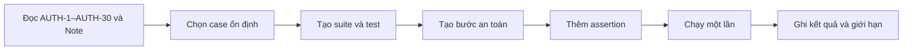

# Kế hoạch automation — Đăng ký / Đăng nhập / Đăng xuất CellphoneS

## 1. Mục tiêu và phạm vi

- **Nguồn test case:** `GroupXX_MaSV_HoTen.xlsx`, sheet `Auth`, AUTH-1–AUTH-30 (AUTH-1–AUTH-15: Đăng ký; AUTH-16–AUTH-28: Đăng nhập; AUTH-29–AUTH-30: Đăng xuất). Kết quả sau khi chạy sẽ ghi vào một bản sao của workbook (hậu tố `_v1`), giữ nguyên bản gốc.
- **Môi trường:** Chrome, Ghost Inspector, viewport desktop 1280 × 800 px. Chưa có lượt chạy trên viewport di động.
- **Mục tiêu:** kiểm tra giao diện và điều hướng của form đăng ký, form đăng nhập và đăng xuất bằng assertion về text, phần tử và URL. Mỗi test tự mở Start URL, không dựa vào trạng thái của test khác.
- **Ngoài phạm vi chạy tự động:** tạo tài khoản thật (AUTH-2), nhập mã OTP nếu web yêu cầu, vượt captcha, đăng ký/đăng nhập bằng Google hoặc Zalo, nhập sai mật khẩu liên tiếp để thử khóa tài khoản, gửi payload script/SQL lên website, Back/Forward của trình duyệt. Các chức năng quên mật khẩu, đặt lại mật khẩu, đổi mật khẩu không thuộc phạm vi của kế hoạch này.

## 2. Chọn case

| Case | Ưu tiên | Automate | Lý do |
| --- | --- | --- | --- |
| AUTH-1 | P1 | Yes | Mở form đăng ký từ form đăng nhập; kiểm tra bằng liên kết và phần tử form. |
| AUTH-2 | P1 | No | Tạo tài khoản thật, SĐT/email chỉ dùng được một lần, có thể phát sinh bước OTP. |
| AUTH-3 | P1 | No | Phụ thuộc AUTH-2 (tài khoản vừa đăng ký). |
| AUTH-4 | P1 | Yes | Để trống tất cả trường; assert có thông báo yêu cầu nhập. |
| AUTH-5 | P2 | Yes | Bỏ trống từng trường; assert thông báo đúng trường. |
| AUTH-6 | P2 | Yes | SĐT sai định dạng; dữ liệu cố định, assert thông báo lỗi. |
| AUTH-7 | P1 | Yes | SĐT đã có tài khoản; không tạo tài khoản mới, assert thông báo. |
| AUTH-8 | P2 | Yes | Email sai định dạng; assert thông báo lỗi. |
| AUTH-9 | P2 | Yes | Email đã có tài khoản; assert thông báo. |
| AUTH-10 | P2 | Yes | Mật khẩu không đạt yêu cầu; dữ liệu cố định, assert thông báo. |
| AUTH-11 | P3 | Yes | Xác nhận mật khẩu không khớp; chỉ chạy nếu form có ô nhập lại. |
| AUTH-12 | P2 | Yes | Không tích điều khoản; assert thông báo hoặc nút bị vô hiệu. |
| AUTH-13 | P3 | Yes | Họ tên không hợp lệ; dữ liệu cố định. |
| AUTH-14 | P3 | No | Kết quả mong đợi mở (loại khoảng trắng hoặc báo lỗi) và có thể tạo tài khoản thật. |
| AUTH-15 | P2 | No | Payload script/SQL có thể bị tường lửa chặn (HTTP 403) trước khi ứng dụng xử lý. |
| AUTH-16 | P1 | Yes | Đăng nhập thành công; assert tên tài khoản hiển thị trên header. |
| AUTH-17 | P1 | Yes | Sai mật khẩu; assert thông báo sai thông tin đăng nhập. |
| AUTH-18 | P1 | Yes | SĐT chưa đăng ký; assert thông báo lỗi. |
| AUTH-19 | P1 | Yes | Để trống cả hai trường; assert thông báo yêu cầu nhập. |
| AUTH-20 | P2 | Yes | Chỉ bỏ trống một trường; assert thông báo đúng trường. |
| AUTH-21 | P2 | Yes | SĐT sai định dạng; dữ liệu cố định. |
| AUTH-22 | P3 | Yes | SĐT có khoảng trắng đầu/cuối; assert theo hành vi quan sát được. |
| AUTH-23 | P2 | Yes | Mật khẩu phân biệt hoa/thường; đổi hoa/thường rồi assert đăng nhập thất bại. |
| AUTH-24 | P3 | Yes | Nút ẩn/hiện mật khẩu; assert thuộc tính loại ô nhập (nếu có biểu tượng). |
| AUTH-25 | P2 | No | Nhập sai nhiều lần có thể khóa tài khoản test hoặc bật captcha. |
| AUTH-26 | P2 | No | Payload SQL injection có thể bị tường lửa chặn; không gửi tự động. |
| AUTH-27 | P2 | No | Payload XSS có thể bị tường lửa chặn; không gửi tự động. |
| AUTH-28 | P2 | Yes | Chỉ tự động bước tải lại trang (F5); bước đóng/mở lại tab kiểm tra thủ công. |
| AUTH-29 | P1 | Yes | Đăng xuất; assert nút Đăng nhập hiện lại trên header. |
| AUTH-30 | P3 | No | Back của trình duyệt phụ thuộc lịch sử tab; kết quả có thể do cache. |

Tổng cộng **22 case đưa vào Ghost Inspector**, **8 case chạy thủ công** (AUTH-2, 3, 14, 15, 25, 26, 27, 30).

## 3. Cấu trúc Ghost Inspector

- **Suite:** `CellphoneS - Auth`.
- **Thiết lập chung:** Chrome, desktop 1280 × 800 px; mỗi test bắt đầu từ Start URL riêng và chạy độc lập. Ghost Inspector tự chờ phần tử trong từng bước, không thêm bước sleep cố định.
- **Tài khoản và dữ liệu nhạy cảm:** dùng một tài khoản test riêng (không dùng tài khoản cá nhân). Mật khẩu và SĐT để trong biến của suite/test, không ghi cứng vào bước.
- **Assertion ưu tiên:** text/element present, URL contains. Chọn phần tử theo nhãn hiển thị hoặc thuộc tính ổn định sau khi record; tránh selector dựa trên thứ tự DOM.

| Test dự kiến | Case | Start URL | Bước và assertion tối thiểu |
| --- | --- | --- | --- |
| `AUTH_01_open_register_form` | AUTH-1 | `/` | Bấm [Đăng nhập] trên header; bấm [Đăng ký ngay]; assert hiển thị form đăng ký có nút [Đăng ký]. |
| `AUTH_04_AUTH_05_register_empty` | AUTH-4, AUTH-5 | `/` | Mở form đăng ký; bấm [Đăng ký] khi để trống; assert có thông báo yêu cầu nhập. Lặp với từng trường bị bỏ trống. |
| `AUTH_06_register_invalid_phone` | AUTH-6 | `/` | Nhập lần lượt các SĐT sai định dạng; assert thông báo SĐT không hợp lệ. |
| `AUTH_07_register_existing_phone` | AUTH-7 | `/` | Nhập SĐT đã đăng ký, các trường khác hợp lệ; assert thông báo SĐT đã tồn tại. |
| `AUTH_08_register_invalid_email` | AUTH-8 | `/` | Nhập lần lượt các email sai định dạng; assert thông báo email không hợp lệ. |
| `AUTH_09_register_existing_email` | AUTH-9 | `/` | Nhập email đã đăng ký; assert thông báo email đã được sử dụng. |
| `AUTH_10_register_weak_password` | AUTH-10 | `/` | Nhập lần lượt các mật khẩu không đạt; assert thông báo mật khẩu không hợp lệ. |
| `AUTH_11_AUTH_12_register_confirm_terms` | AUTH-11, AUTH-12 | `/` | Nhập mật khẩu xác nhận khác nhau, rồi bỏ tích điều khoản; assert thông báo hoặc nút [Đăng ký] bị vô hiệu. |
| `AUTH_13_register_invalid_name` | AUTH-13 | `/` | Nhập họ tên chỉ gồm số, ký tự đặc biệt, chuỗi quá dài; assert thông báo họ tên không hợp lệ. |
| `AUTH_16_login_success` | AUTH-16 | `/` | Đăng nhập bằng tài khoản test; assert tên tài khoản hiển thị trên header. |
| `AUTH_29_logout` | AUTH-29 | `/` | Tự đăng nhập bằng tài khoản test; bấm [Đăng xuất]; assert nút [Đăng nhập] hiện lại và tên tài khoản không còn hiển thị. |
| `AUTH_17_AUTH_18_login_invalid` | AUTH-17, AUTH-18 | `/` | Đăng nhập sai mật khẩu, rồi SĐT chưa đăng ký; assert thông báo lỗi, header vẫn hiện nút [Đăng nhập]. |
| `AUTH_19_AUTH_20_login_empty` | AUTH-19, AUTH-20 | `/` | Bấm [Đăng nhập] khi để trống cả hai trường, rồi chỉ bỏ trống một trường; assert thông báo. |
| `AUTH_21_login_invalid_phone` | AUTH-21 | `/` | Nhập lần lượt các SĐT sai định dạng; assert thông báo lỗi, không đăng nhập. |
| `AUTH_22_login_trim_spaces` | AUTH-22 | `/` | Nhập SĐT có khoảng trắng đầu/cuối; ghi lại hành vi quan sát được và assert theo kết quả đã xác minh. |
| `AUTH_23_login_password_case` | AUTH-23 | `/` | Nhập mật khẩu đổi hoa/thường; assert đăng nhập thất bại. |
| `AUTH_24_toggle_password_visibility` | AUTH-24 | `/` | Bấm biểu tượng con mắt; assert loại ô nhập đổi giữa dạng ẩn và dạng hiện. |
| `AUTH_28_session_after_reload` | AUTH-28 | `/` | Đăng nhập; tải lại trang; assert tên tài khoản vẫn hiển thị trên header. |

Các test cần được tạo thủ công trong trình chỉnh sửa bước của Ghost Inspector nếu recorder chưa được cài trên Chrome. Trước khi chạy, rà lại Start URL, selector và xác nhận test không thao tác đặt hàng, đổi mật khẩu hay tạo tài khoản mới.

## 4. Quy ước và dữ liệu

- Base URL: `https://cellphones.com.vn`.
- Dữ liệu test dùng chung (giá trị thật nằm trong biến của Ghost Inspector, không ghi vào tài liệu này):
  - `SDT_DA_DK`, `EMAIL_DA_DK`, `MK_DUNG`: tài khoản test đã đăng ký.
  - `MK_SAI`: mật khẩu sai (`Sai@9999`).
  - `SDT_CHUA_DK`, `EMAIL_CHUA_DK`: SĐT và email hợp lệ chưa đăng ký, chỉ dùng cho các case lỗi.
  - `HOTEN`, `MK_DK`: họ tên và mật khẩu hợp lệ khi đăng ký.
- Không ghi cứng nội dung thông báo lỗi trước khi quan sát; sau khi chạy lần đầu, ghi lại text thực tế rồi mới đưa vào assertion. Không dùng dữ liệu cá nhân thật ngoài tài khoản test.
- Tên test bắt đầu bằng ID; mỗi assertion có mô tả ngắn về điều được kiểm tra.

## 5. Rủi ro và cách xử lý

| Rủi ro | Cách xử lý |
| --- | --- |
| Captcha hoặc chặn bot khi đăng nhập từ máy chủ Ghost Inspector | Dừng test bị ảnh hưởng, ghi lỗi thật; chuyển case sang chạy thủ công, không tìm cách vượt chặn. |
| Test fail lan sang test phụ thuộc (AUTH-2 → AUTH-3; AUTH-16 → AUTH-28, AUTH-29; AUTH-29 → AUTH-30) | Chạy theo thứ tự ID; khi case gốc fail, ghi lý do và đánh dấu case phụ thuộc (Failed hoặc Blocked theo quy ước nhóm), không chạy lại liên tục. |
| Chạy liên tục trên web thật làm kích hoạt giới hạn (captcha, khóa tạm tài khoản test) | Giãn thời gian giữa các test; chạy AUTH-25 sau cùng; chờ hết thời gian khóa trước khi chạy lại các case cần đăng nhập. |
| Bước OTP khi đăng ký hoặc đăng nhập | Không tự động hóa; ghi Blocked hoặc chạy thủ công bằng SĐT/email của chính mình. |
| Nhập sai mật khẩu nhiều lần làm khóa tài khoản test | Không đưa AUTH-25 vào Ghost Inspector; giới hạn số lần thử sai ở mức tối thiểu. |
| Payload script/SQL bị HTTP 403 | Không chạy tự động; nếu thử thủ công, ghi nhận trang chặn là kết quả quan sát, không kết luận về cách ứng dụng xử lý. |
| Tạo tài khoản rác | Chỉ chạy AUTH-2 thủ công một lần cho mỗi bộ SĐT/email; không lặp trong suite. |
| Lộ mật khẩu test | Dùng tài khoản riêng cho test; lưu thông tin trong biến của suite; không đưa vào tài liệu. |
| Popup/banner che phần tử | Chờ UI ổn định; đóng popup bằng thao tác UI được record nếu xuất hiện. Không chặn script hay vượt cơ chế website. |
| Nhãn nút, tên trường thay đổi | Đối chiếu lại nhãn trên form thật trước khi record; chỉ assert các phần tử đã xác nhận tồn tại. |
| Giới hạn gói Ghost Inspector | Ghi giới hạn thực tế ở mục 8, dừng tạo/chạy khi hết quyền hoặc lượt. |
| Dữ liệu trình duyệt tồn tại (phiên đăng nhập cũ) | Mỗi test có Start URL; test đăng nhập tự đăng xuất hoặc bắt đầu ở trạng thái chưa đăng nhập. |

## 6. Checklist triển khai

- [ ] Đối chiếu form đăng ký và form đăng nhập thật (tên trường, nhãn nút, có hay không ô nhập lại mật khẩu, có hay không bước OTP).
- [ ] Chuẩn bị tài khoản test riêng và các bộ dữ liệu `SDT_*`, `EMAIL_*`.
- [ ] Tạo suite `CellphoneS - Auth`.
- [ ] Tạo 18 test trong bảng mục 3.
- [ ] Thêm và kiểm tra assertion text/element/URL.
- [ ] Chạy mỗi test một lần.
- [ ] Ghi pass/fail thực tế và URL kết quả.
- [ ] Chạy thủ công AUTH-2, 3, 14, 15, 25, 26, 27, 30.
- [ ] Kiểm tra các test Ghost Inspector không có bước tạo tài khoản, quên/đổi mật khẩu hoặc gửi payload.
- [ ] Ghi kết quả vào cột Result của sheet `Auth` trong bản sao workbook; giữ các case chưa chạy ở trạng thái `Untested`.
- [ ] Đối chiếu thống kê sheet `Auth` với sheet `Test Report`.

## 7. Quy trình

## 8. Kết quả dự đoán và giới hạn

**Lưu ý quan trọng:** chưa có lượt chạy nào. Các số liệu dưới đây là **dự đoán** dựa trên thiết kế test case và hành vi thường gặp của form đăng ký/đăng nhập; chưa được xác minh trên website thật. Cột "Kết quả thật" để trống cho đến khi chạy.

**Thống kê dự đoán khi chạy liên tục theo thứ tự ID, cùng một IP và một tài khoản test: 24 Passed, 6 Failed, 0 Untested (trên 30 case).**

Vì đây là web thật nên các lượt test liên tiếp ảnh hưởng lẫn nhau. So với lần tính đầu (26 Passed, 4 Failed), có hai thay đổi:

- **AUTH-25 chuyển từ Failed sang Passed.** Khi chạy liên tục, số lần sai mật khẩu trên tài khoản test tích lũy qua AUTH-17, AUTH-22, AUTH-23 và 5 lần của chính AUTH-25. Nhiều khả năng đã vượt ngưỡng nên hệ thống hiện captcha hoặc khóa tạm, khớp với Expected.
- **AUTH-28, AUTH-29, AUTH-30 chuyển sang Failed.** Sau khi tài khoản test bị khóa hoặc yêu cầu captcha, AUTH-28 và AUTH-29 không đăng nhập được. AUTH-30 phụ thuộc AUTH-29 nên cũng Failed.

Ba case còn lại là **AUTH-10, AUTH-13, AUTH-22**: Failed độc lập vì Expected trong Excel không khớp hành vi thực tế của web (xem bảng).

**Chuỗi phụ thuộc** (cột Inter-test case Dependence trong sheet `Auth`): AUTH-2 → AUTH-3; AUTH-16 → AUTH-28 và AUTH-29; AUTH-29 → AUTH-30. Case gốc fail thì các case phía sau fail theo. Khi ghi vào Excel, nếu nhóm quy ước case phụ thuộc không chạy được là `Blocked` thì kết quả sẽ là 3 Failed (AUTH-10, 13, 22) và 3 Blocked (AUTH-28, 29, 30).

**Biên dao động: 4–8 Failed.** Nếu web không giới hạn số lần đăng nhập sai thì AUTH-25 là Failed nhưng AUTH-28/29/30 là Passed (4 Failed). Nếu AUTH-10 vô tình tạo tài khoản thật bằng `SDT_CHUA_DK`, thì AUTH-11 và AUTH-12 có thể nhận thông báo "đã đăng ký" thay vì lỗi mong đợi (tối đa 8 Failed). Bốn case khác có thể thành Blocked/Skipped thay vì Passed nếu giả định về form không đúng: AUTH-2 và AUTH-3 (nếu có bước OTP), AUTH-11 (nếu không có ô nhập lại mật khẩu), AUTH-24 (nếu không có biểu tượng hiện/ẩn).

| Case | Dự đoán | Độ tin cậy | Lý do |
| --- | --- | --- | --- |
| AUTH-1 | Passed | Cao | Hướng dẫn của CellphoneS có liên kết "Đăng ký ngay" dưới nút đăng nhập. |
| AUTH-2 | Passed | Trung bình | Đăng ký thủ công theo hướng dẫn không nhắc đến OTP; nếu web yêu cầu OTP thì thành Blocked. |
| AUTH-3 | Passed | Trung bình | Phụ thuộc AUTH-2; chạy ngay sau AUTH-2 nên chưa bị giới hạn đăng nhập. |
| AUTH-4 | Passed | Cao | Form thường chặn khi để trống. |
| AUTH-5 | Passed | Trung bình | Trường Email có thể không bắt buộc; Note đã ghi cách xử lý. |
| AUTH-6 | Passed | Trung bình | Form thường kiểm tra định dạng SĐT. |
| AUTH-7 | Passed | Cao | Hệ thống phải từ chối SĐT đã có tài khoản. |
| AUTH-8 | Passed | Cao | Kiểm tra định dạng email là chuẩn phổ biến. |
| AUTH-9 | Passed | Trung bình | Có thể dùng thông báo khác hoặc không kiểm tra trùng email. |
| AUTH-10 | **Failed** | Trung bình | Mật khẩu chỉ gồm chữ thường hoặc chỉ gồm số (`abcdefgh`, `12345678`) có thể vẫn được chấp nhận, trái với Expected. |
| AUTH-11 | Passed | Trung bình | Chỉ áp dụng nếu form có ô nhập lại mật khẩu. |
| AUTH-12 | Passed | Cao | Điều khoản là trường bắt buộc trong hướng dẫn đăng ký. |
| AUTH-13 | **Failed** | Trung bình | Họ tên chỉ gồm số hoặc ký tự đặc biệt thường không bị chặn. |
| AUTH-14 | Passed | Trung bình | Expected mở (loại khoảng trắng hoặc báo lỗi, không lỗi hệ thống). |
| AUTH-15 | Passed | Trung bình | Dữ liệu bị lọc hoặc bị tường lửa chặn nên không thực thi script. |
| AUTH-16 | Passed | Cao | Đăng nhập thành công đầu tiên, chưa bị giới hạn. |
| AUTH-17 | Passed | Cao | Sai mật khẩu luôn bị từ chối; mới là lần sai đầu tiên. |
| AUTH-18 | Passed | Cao | Thông báo chung vẫn được tính Passed theo Note. |
| AUTH-19 | Passed | Cao | Form chặn khi để trống. |
| AUTH-20 | Passed | Cao | Form chặn khi thiếu một trường. |
| AUTH-21 | Passed | Trung bình | Ô đăng nhập nhận SĐT hoặc email nên thông báo lỗi có thể khác mô tả. |
| AUTH-22 | **Failed** | Thấp–Trung bình | Web có thể không tự loại khoảng trắng nên đăng nhập thất bại, trái với Expected. |
| AUTH-23 | Passed | Trung bình | Mật khẩu thường phân biệt hoa/thường; đã có vài lần sai trước đó nhưng chưa tới ngưỡng. |
| AUTH-24 | Passed | Trung bình | Chỉ áp dụng nếu có biểu tượng con mắt. |
| AUTH-25 | Passed | Thấp–Trung bình | Số lần sai tích lũy vượt ngưỡng nên web hiện captcha/khóa tạm, khớp Expected. Là nguyên nhân kéo theo AUTH-28, 29, 30. |
| AUTH-26 | Passed | Cao | Form thông thường không bị ảnh hưởng bởi `' OR '1'='1`. |
| AUTH-27 | Passed | Cao | Script không được thực thi. |
| AUTH-28 | **Failed** | Trung bình | Sau AUTH-25 tài khoản test bị khóa/captcha nên không đăng nhập được để kiểm tra tải lại trang. |
| AUTH-29 | **Failed** | Trung bình | Không đăng nhập được do khóa/captcha nên không thực hiện được đăng xuất. |
| AUTH-30 | **Failed** | Trung bình | Phụ thuộc AUTH-29 (cần đã đăng xuất thành công). |

### Kết quả theo test Ghost Inspector (điền sau khi chạy)

| Test | Case | Dự đoán | Kết quả thật | Thời lượng |
| --- | --- | --- | --- | --- |
| `AUTH_01_open_register_form` | AUTH-1 | Passed | Chưa chạy | — |
| `AUTH_04_AUTH_05_register_empty` | AUTH-4, AUTH-5 | Passed | Chưa chạy | — |
| `AUTH_06_register_invalid_phone` | AUTH-6 | Passed | Chưa chạy | — |
| `AUTH_07_register_existing_phone` | AUTH-7 | Passed | Chưa chạy | — |
| `AUTH_08_register_invalid_email` | AUTH-8 | Passed | Chưa chạy | — |
| `AUTH_09_register_existing_email` | AUTH-9 | Passed | Chưa chạy | — |
| `AUTH_10_register_weak_password` | AUTH-10 | Failed | Chưa chạy | — |
| `AUTH_11_AUTH_12_register_confirm_terms` | AUTH-11, AUTH-12 | Passed | Chưa chạy | — |
| `AUTH_13_register_invalid_name` | AUTH-13 | Failed | Chưa chạy | — |
| `AUTH_16_login_success` | AUTH-16 | Passed | Chưa chạy | — |
| `AUTH_17_AUTH_18_login_invalid` | AUTH-17, AUTH-18 | Passed | Chưa chạy | — |
| `AUTH_19_AUTH_20_login_empty` | AUTH-19, AUTH-20 | Passed | Chưa chạy | — |
| `AUTH_21_login_invalid_phone` | AUTH-21 | Passed | Chưa chạy | — |
| `AUTH_22_login_trim_spaces` | AUTH-22 | Failed | Chưa chạy | — |
| `AUTH_23_login_password_case` | AUTH-23 | Passed | Chưa chạy | — |
| `AUTH_24_toggle_password_visibility` | AUTH-24 | Passed | Chưa chạy | — |
| `AUTH_28_session_after_reload` | AUTH-28 | Failed | Chưa chạy | — |
| `AUTH_29_logout` | AUTH-29 | Failed | Chưa chạy | — |

### Giới hạn quan sát được

- Dự đoán dựa trên hướng dẫn công khai của CellphoneS và hành vi thường gặp, chưa mở form thật để đối chiếu từng trường. Tên trường, thông báo lỗi và quy tắc mật khẩu/họ tên cần xác minh khi chạy.
- Một test Ghost Inspector `Passed` chỉ xác nhận những assertion đã cấu hình, không chứng minh toàn bộ Expected Output của test case đã đạt.
- Kết quả phụ thuộc thứ tự chạy và số lần thử trước đó trên cùng IP/tài khoản. Nếu giãn thời gian giữa các lượt hoặc chạy AUTH-25 sau cùng, AUTH-28, 29, 30 có thể Passed.
- Một case `Failed` do Expected trong Excel không khớp với giao diện chưa chắc là lỗi sản phẩm; cần xem lại Expected (như AUTH-10, AUTH-13, AUTH-22) trước khi kết luận.
- Ghost Inspector chạy từ máy chủ đám mây, nên có thể gặp captcha, xác minh bổ sung hoặc HTTP 403 khi đăng nhập. Nếu gặp, ghi lại hiện tượng thật và chuyển case sang chạy thủ công.
- Kết quả đăng ký phụ thuộc vào việc SĐT/email test còn chưa được dùng; mỗi bộ dữ liệu chỉ dùng được một lần.
- AUTH-28 chỉ tự động hóa phần tải lại trang; phần đóng và mở lại tab cần kiểm tra thủ công.

## 9. Case chạy thủ công

Các case dưới đây không đưa vào Ghost Inspector vì tạo dữ liệu thật, có nguy cơ khóa tài khoản hoặc bị tường lửa chặn. Kết quả thủ công không được tính là lượt Ghost Inspector.

| Case | Cách chạy | Dự đoán | Lưu ý an toàn |
| --- | --- | --- | --- |
| AUTH-2 | Chrome, thủ công, một lần | Passed (Blocked nếu có OTP) | Dùng SĐT/email của chính mình; ghi lại SĐT/email đã dùng để đổi cho lần sau. |
| AUTH-3 | Chrome, thủ công, ngay sau AUTH-2 | Passed | Chỉ chạy khi AUTH-2 thành công. |
| AUTH-14 | Chrome, thủ công | Passed | Có thể tạo tài khoản thật; dùng SĐT/email chưa dùng và ghi lại hành vi thực tế. |
| AUTH-15 | Chrome, thủ công | Passed | Chỉ nhập vào form thông thường; nếu gặp HTTP 403 thì ghi nhận, không tìm cách vượt. |
| AUTH-25 | Chrome, thủ công | Passed (kéo theo AUTH-28, 29, 30 Failed) | Dùng tài khoản test; dừng ngay khi bị khóa hoặc hiện captcha, ghi lại ngưỡng thực tế. |
| AUTH-26 | Chrome, thủ công | Passed | Chỉ nhập vào form đăng nhập thông thường. |
| AUTH-27 | Chrome, thủ công | Passed | Chỉ nhập vào form đăng nhập thông thường. |
| AUTH-30 | Chrome, thủ công | Failed (phụ thuộc AUTH-29) | Kiểm tra cả nút Back và truy cập trực tiếp trang thông tin tài khoản sau khi đăng xuất. |
