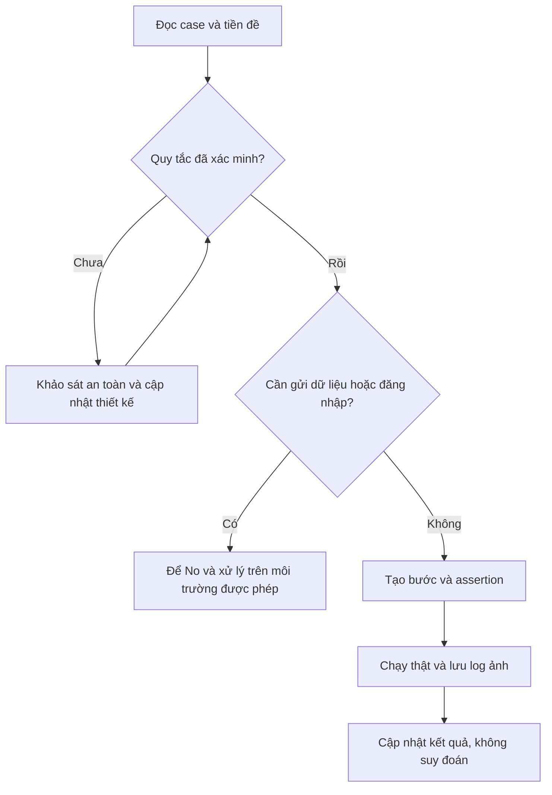

# Kế hoạch automation — So sánh và Đánh giá sản phẩm

Sinh viên: Trịnh Quang Thông — 22130275 — Group15. Thiết kế cập nhật 31/10/2026.

## Nguồn và phạm vi

- Workbook chính: `../testcases/Group15_22130275_TrinhQuangThong.xlsx`.
- So sánh: https://cellphones.com.vn/so-sanh/iphone-17-256gb. Bảng một sản phẩm có ba vị trí; nút thêm mở hộp tìm; phải nhấn + Chọn để so sánh để thêm. Giới hạn sản phẩm thứ tư đã kiểm tra bằng khay UI ngày03/11 và Playwright ngày05/11, xem báo cáo theo ngày.
- Đánh giá: https://cellphones.com.vn/iphone-17-256gb.html. Có bộ lọc sao/ảnh/mua hàng, form sao+nội dung, placeholder tối thiểu 15 kí tự. Trong phiên tài khoản đang có, không thấy trường họ tên/SĐT/email trong form đánh giá. Chưa xác minh luồng khách chưa đăng nhập.
- Trước 05/11/2026 chưa tạo/chạy test Ghost Inspector hoặc Playwright cho CP/RV. Xem phần cập nhật 05/11 cuối tài liệu cho script mới. Ngày 02/11/2026 đã kiểm tra Chrome thật: 51 Passed, 3 Untested; xem [báo cáo thực thi](22130275_CP_RV_execution-20261102.md). Lựa chọn Automate không đồng nghĩa đã chạy automation.
- PD giữ kế hoạch và bằng chứng lịch sử trong automation-plan.md; lựa chọn Yes/No trong đó dành cho Ghost Inspector giai đoạn ASM6, không áp đặt cho script Playwright ASM7/ASM8.

## Quy tắc chọn case

Yes: có assertion UI rõ, không cần gửi dữ liệu hoặc đăng nhập trong test. No: quy tắc chưa xác minh, cần phiên tài khoản/form, cần kiểm tra trực quan hoặc có thể gửi dữ liệu thật. Sau khi xác minh có thể đổi lựa chọn theo từng case, không đổi hàng loạt.

## Danh sách case

| ID | Mục tiêu | Automate | Lý do |
|---|---|---|---|
| PRODUCT_COMPARE_PAGE_Open_01 | Mở bảng so sánh một sản phẩm | Yes | Có thể assert text, trạng thái chọn hoặc phần tử; không gửi form/mua hàng. |
| PRODUCT_COMPARE_LIST_Add_01 | Thêm iPhone 17 từ trang chi tiết | Yes | Có thể assert text, trạng thái chọn hoặc phần tử; không gửi form/mua hàng. |
| PRODUCT_COMPARE_SEARCH_Open_01 | Mở hộp tìm sản phẩm so sánh | Yes | Có thể assert text, trạng thái chọn hoặc phần tử; không gửi form/mua hàng. |
| PRODUCT_COMPARE_SEARCH_Search_01 | Tìm sản phẩm theo tên | Yes | Có thể assert text, trạng thái chọn hoặc phần tử; không gửi form/mua hàng. |
| PRODUCT_COMPARE_LIST_Add_02 | Thêm sản phẩm thứ hai cùng hãng | Yes | Có thể assert text, trạng thái chọn hoặc phần tử; không gửi form/mua hàng. |
| PRODUCT_COMPARE_LIST_Add_03 | Thêm sản phẩm khác hãng | Yes | Có thể assert text, trạng thái chọn hoặc phần tử; không gửi form/mua hàng. |
| PRODUCT_COMPARE_LIST_Add_04 | Thêm sản phẩm thứ ba vào ô cuối | Yes | Có thể assert text, trạng thái chọn hoặc phần tử; không gửi form/mua hàng. |
| PRODUCT_COMPARE_LIST_Limit_01 | Thử thêm sản phẩm thứ tư | Yes | Đã xác minh khay giữ ba mục khi thêm mục thứ tư bằng điều hướng trong website; assert số mục và tên. |
| PRODUCT_COMPARE_LIST_Duplicate_01 | Thêm lại sản phẩm đang có | Yes | Đã xác minh nhấn So sánh hai lần trên cùng PDP không tạo mục trùng; assert một mục và nhãn khay. |
| PRODUCT_COMPARE_LIST_Remove_01 | Bỏ một sản phẩm khỏi bảng hai cột | Yes | Có thể assert text, trạng thái chọn hoặc phần tử; không gửi form/mua hàng. |
| PRODUCT_COMPARE_LIST_Remove_02 | Bỏ sản phẩm duy nhất | Yes | Có thể assert text, trạng thái chọn hoặc phần tử; không gửi form/mua hàng. |
| PRODUCT_COMPARE_LIST_Replace_01 | Thêm lại vào ô đã bỏ | Yes | Có thể assert text, trạng thái chọn hoặc phần tử; không gửi form/mua hàng. |
| PRODUCT_COMPARE_SPECS_View_01 | Hiển thị nhóm Thông tin cơ bản | Yes | Có thể assert text, trạng thái chọn hoặc phần tử; không gửi form/mua hàng. |
| PRODUCT_COMPARE_SPECS_View_02 | Đối chiếu dung lượng của iPhone gốc | Yes | Có thể assert text, trạng thái chọn hoặc phần tử; không gửi form/mua hàng. |
| PRODUCT_COMPARE_SPECS_View_03 | Các sản phẩm có ô cùng hàng thông số | Yes | Có thể assert text, trạng thái chọn hoặc phần tử; không gửi form/mua hàng. |
| PRODUCT_COMPARE_SPECS_Open_01 | Mở so sánh cấu hình chi tiết | Yes | Có thể assert text, trạng thái chọn hoặc phần tử; không gửi form/mua hàng. |
| PRODUCT_COMPARE_SEARCH_Search_02 | Từ khóa không có kết quả | Yes | Có thể assert text, trạng thái chọn hoặc phần tử; không gửi form/mua hàng. |
| PRODUCT_COMPARE_SEARCH_Clear_01 | Xóa nội dung tìm kiếm | Yes | Có thể assert text, trạng thái chọn hoặc phần tử; không gửi form/mua hàng. |
| PRODUCT_COMPARE_SEARCH_Input_01 | Nhập chỉ khoảng trắng | Yes | Có thể assert text, trạng thái chọn hoặc phần tử; không gửi form/mua hàng. |
| PRODUCT_COMPARE_SEARCH_Input_02 | Nhập ký tự đặc biệt | Yes | Có thể assert text, trạng thái chọn hoặc phần tử; không gửi form/mua hàng. |
| PRODUCT_COMPARE_SEARCH_Input_03 | Nhập từ khóa tiếng Việt có dấu | Yes | Có thể assert text, trạng thái chọn hoặc phần tử; không gửi form/mua hàng. |
| PRODUCT_COMPARE_PAGE_Reload_01 | Tải lại bảng từ URL đang mở | Yes | Có thể assert text, trạng thái chọn hoặc phần tử; không gửi form/mua hàng. |
| PRODUCT_COMPARE_PAGE_Open_02 | Mở trực tiếp URL bảng một sản phẩm | Yes | Có thể assert text, trạng thái chọn hoặc phần tử; không gửi form/mua hàng. |
| PRODUCT_COMPARE_PAGE_View_01 | Kiểm tra đích liên kết Mua ngay, không bấm | Yes | Có thể assert text, trạng thái chọn hoặc phần tử; không gửi form/mua hàng. |
| PRODUCT_COMPARE_PAGE_Responsive_01 | Bảng so sánh trên chiều rộng 390px | No | Kiểm tra trực quan bố cục mobile. |
| PRODUCT_REVIEW_SUMMARY_View_01 | Hiển thị tiêu đề khu vực đánh giá | Yes | Có thể assert text, trạng thái chọn hoặc phần tử; không gửi form/mua hàng. |
| PRODUCT_REVIEW_SUMMARY_View_02 | Hiển thị điểm trung bình | Yes | Có thể assert text, trạng thái chọn hoặc phần tử; không gửi form/mua hàng. |
| PRODUCT_REVIEW_SUMMARY_View_03 | Hiển thị tổng lượt đánh giá | Yes | Có thể assert text, trạng thái chọn hoặc phần tử; không gửi form/mua hàng. |
| PRODUCT_REVIEW_SUMMARY_View_04 | Hiển thị phân bố đủ năm mức sao | Yes | Có thể assert text, trạng thái chọn hoặc phần tử; không gửi form/mua hàng. |
| PRODUCT_REVIEW_SUMMARY_View_05 | Hiển thị điểm đánh giá trải nghiệm | Yes | Có thể assert text, trạng thái chọn hoặc phần tử; không gửi form/mua hàng. |
| PRODUCT_REVIEW_FILTER_Select_01 | Lọc đánh giá 5 sao | Yes | Có thể assert text, trạng thái chọn hoặc phần tử; không gửi form/mua hàng. |
| PRODUCT_REVIEW_FILTER_Select_02 | Lọc mức 4 sao đang không có dữ liệu | Yes | Có thể assert text, trạng thái chọn hoặc phần tử; không gửi form/mua hàng. |
| PRODUCT_REVIEW_FILTER_Select_03 | Lọc mức 3 sao đang không có dữ liệu | Yes | Có thể assert text, trạng thái chọn hoặc phần tử; không gửi form/mua hàng. |
| PRODUCT_REVIEW_FILTER_Select_04 | Lọc mức 2 sao đang không có dữ liệu | Yes | Có thể assert text, trạng thái chọn hoặc phần tử; không gửi form/mua hàng. |
| PRODUCT_REVIEW_FILTER_Select_05 | Lọc mức 1 sao đang không có dữ liệu | Yes | Có thể assert text, trạng thái chọn hoặc phần tử; không gửi form/mua hàng. |
| PRODUCT_REVIEW_FILTER_Clear_01 | Trở về Tất cả sau khi lọc sao | Yes | Có thể assert text, trạng thái chọn hoặc phần tử; không gửi form/mua hàng. |
| PRODUCT_REVIEW_FILTER_Select_06 | Lọc đánh giá Có hình ảnh | Yes | Có thể assert text, trạng thái chọn hoặc phần tử; không gửi form/mua hàng. |
| PRODUCT_REVIEW_FILTER_Select_07 | Lọc đánh giá Đã mua hàng | Yes | Có thể assert text, trạng thái chọn hoặc phần tử; không gửi form/mua hàng. |
| PRODUCT_REVIEW_LIST_Open_01 | Mở Xem tất cả đánh giá | Yes | Có thể assert text, trạng thái chọn hoặc phần tử; không gửi form/mua hàng. |
| PRODUCT_REVIEW_FORM_Open_01 | Mở form khi tài khoản thường đã đăng nhập | No | Cần phiên tài khoản có sẵn; chỉ thao tác form trước gửi. |
| PRODUCT_REVIEW_FORM_View_01 | Hiển thị năm nhãn đánh giá sao | No | Cần phiên tài khoản có sẵn; chỉ thao tác form trước gửi. |
| PRODUCT_REVIEW_RATING_Select_01 | Chọn mức sao thấp nhất | No | Cần phiên tài khoản có sẵn; chỉ thao tác form trước gửi. |
| PRODUCT_REVIEW_RATING_Switch_01 | Đổi từ sao thấp nhất sang cao nhất | No | Cần phiên tài khoản có sẵn; chỉ thao tác form trước gửi. |
| PRODUCT_REVIEW_CONTENT_View_01 | Hiển thị hướng dẫn tối thiểu 15 ký tự | No | Cần phiên tài khoản có sẵn; chỉ thao tác form trước gửi. |
| PRODUCT_REVIEW_CONTENT_Clear_01 | Xóa nội dung về rỗng trước khi gửi | No | Cần phiên tài khoản có sẵn; chỉ thao tác form trước gửi. |
| PRODUCT_REVIEW_CONTENT_Validate_01 | Nội dung ngắn hơn hướng dẫn tối thiểu | No | Cần xác minh đầy đủ quy tắc trước automation. |
| PRODUCT_REVIEW_CONTENT_Input_01 | Nhập đúng 15 ký tự, chưa gửi | No | Cần phiên tài khoản có sẵn; chỉ thao tác form trước gửi. |
| PRODUCT_REVIEW_CONTENT_Input_02 | Nhập 16 ký tự, chưa gửi | No | Cần phiên tài khoản có sẵn; chỉ thao tác form trước gửi. |
| PRODUCT_REVIEW_CONTENT_Limit_01 | Nhập nội dung dài 1000 ký tự | No | Cần xác minh đầy đủ quy tắc trước automation. |
| PRODUCT_REVIEW_CONTENT_Validate_02 | Nội dung chỉ có 15 dấu cách | No | Cần xác minh đầy đủ quy tắc trước automation. |
| PRODUCT_REVIEW_CONTENT_Input_03 | Nhập ký tự đặc biệt dưới dạng văn bản | No | Cần phiên tài khoản có sẵn; chỉ thao tác form trước gửi. |
| PRODUCT_REVIEW_CONTENT_Input_04 | Nhập tiếng Việt và emoji | No | Cần phiên tài khoản có sẵn; chỉ thao tác form trước gửi. |
| PRODUCT_REVIEW_CONTENT_Security_01 | Nhập chuỗi script như văn bản, không gửi | No | Cần phiên tài khoản có sẵn; chỉ thao tác form trước gửi. |
| PRODUCT_REVIEW_ATTACHMENT_View_01 | Hiển thị tùy chọn thêm ảnh và loại file khai báo | No | Cần phiên tài khoản có sẵn; chỉ thao tác form trước gửi. |

## Cách tổ chức dự kiến

- Suite So sánh sản phẩm và Suite Đánh giá sản phẩm, độc lập với suite PD. Tên test bắt đầu ID đầy đủ trong Excel.
- Chrome desktop 1280×800, một worker khi dùng Playwright. Mỗi test tự mở URL và tự chuẩn bị dữ liệu; không dựa vào kết quả case trước.
- So sánh: chờ dữ liệu và hộp tìm, xác nhận đúng sản phẩm bằng tên và + Chọn để so sánh; không assert giá hoặc thứ tự gợi ý. Phải xác minh nút bỏ và dọn danh sách trước khi triển khai các case thêm/xóa.
- Đánh giá: chờ danh sách tải xong rồi đối chiếu lọc; case dữ liệu rỗng cần xác nhận thống kê mức sao bằng 0. Khi dữ liệu đổi, chuẩn bị lại tiền đề thay vì ép Pass.
- Form: không đăng nhập tự động, không lưu mật khẩu/cookie. Không nhấn GỬI ĐÁNH GIÁ, không upload file, không tạo đánh giá bằng dữ liệu giả trên website thật.
- Chuỗi script đã kiểm tra như văn bản trong textarea, không mở URL payload, không gửi. Không kết luận về stored XSS.
- Khi gặp 403/captcha/quota, dừng phần liên quan và ghi lý do.

## Checklist

- [x] Khôi phục bản nháp CP/RV cũ và thiết kế lại theo UI quan sát.
- [x] Chuẩn hóa ID đầy đủ, input, bước, trạng thái Untested và Test Design.
- [x] Tách các quy tắc chưa xác minh trong Expected, không bịa giới hạn hay thông báo.
- [ ] Xác minh các ô CẦN XÁC MINH trong workbook.
- [x] Kiểm tra trang đánh giá đầy đủ, trạng thái sau lọc và xóa so sánh.
- [x] Hoàn tất giới hạn sản phẩm thứ tư và thêm trùng ngày 03/11/2026; có ảnh và nhật ký quan sát.
- [ ] Xác minh ba quy tắc RV về validation/giới hạn trên môi trường cho phép gửi dữ liệu thử.
- [x] Dùng phiên tài khoản thường đang có để kiểm tra UI form; không đăng nhập và không lưu thông tin xác thực.
- [x] Tạo test các case Yes, thêm assertion và chạy thử Playwright ngày 05/11; giữ baseline lỗi và các lần sửa.
- [x] Chạy lại CP/RV hai lượt đầy đủ ngày 05/11, cùng spec/fixture/config: 39 Passed, 0 Failed, 15 Skipped. Lưu ảnh/log ở ASM8. Workbook giữ lịch sử kiểm tra thủ công, không thay bằng kết quả automation. Tiếp tục theo dõi flaky dài hạn.

## Quy trình

## Thực thi ngày 02/11/2026

Ngày 02/11 có 49 case CP/RV Passed, 5 Untested; ngày 03/11 hoàn tất thêm hai case CP, hiện 51 Passed/3 Untested. Xem [bảng kết quả và ảnh từng case](22130275_CP_RV_execution-20261102.md). Đó là trạng thái lịch sử ngày02–03/11. Đến05/11 đã có script và hai lượt chạy Playwright CP/RV cùng source, xem mục cập nhật05/11. Chưa chạy Ghost Inspector choCP/RV, không bắt buộc dùng thêm công cụ thứ hai theo đề.

## Cập nhật ngày 03/11/2026

CP đã kiểm tra đủ 25 case; RV 26 Passed/3 Untested. Workbook tổng 79 Passed/3 Untested. Hai case CP chuyển Automate: Yes; chưa tạo script/run automation CP/RV. [Báo cáo mới nhất, ô đã sửa và ảnh](22130275_CP_RV_followup-20261103.md). Trang chi tiết SP!E9:E36 đã điền Không.

## Triển khai Playwright ngày 05/11/2026

Project: `../assignment8/Automation Testing Project - Group 15/`. Có project cp (25 khai báo) và rv (29 khai báo), chạy độc lập hoặc chung với pd. Đã đối chiếu toàn bộ ID với workbook. Xem [implementation](../assignment8/CP-RV-IMPLEMENTATION.md) và [báo cáo kết quả](../assignment8/CP-RV-RUN-REPORT.md).

38 case Yes trong bảng gốc có implementation, thêm kiểm tra tự động một phần cho CP Responsive (geometry và thao tác UI). Giữ lựa chọn No cho phần đánh giá trực quan đầy đủ và không đổi workbook hàng loạt. 15 case RV form/validation giữ Skipped có lý do, không coi là đã triển khai hoặc đã chạy chỉ vì có tên trong suite. Không sử dụng kết quả thủ công để lấp kết quả Skipped.

Lỗi script đã xác định trong quá trình chạy: scope locator, khoảng trắng nhãn sao, thông báo rỗng gồm hai câu trong cùng paragraph, hai hộp tìm CP có placeholder/nút khác nhau, popup cookie chặn cleanup. Sửa locator và chờ UI, giữ Expected. Không force click hoặc gỡ overlay bằng JavaScript.

Workbook và bộ nộp PD vẫn giữ nguyên trong lần triển khai này. Ba Expected RV CẦN XÁC MINH tiếp tục giữ nguyên cho đến khi có đặc tả/môi trường kiểm thử phù hợp.

Lượt đủ sau sửa asm8-20261105221047-29496: CP 25 Passed, RV 14 Passed/15 Skipped, tổng 54 khai báo, 341,11 giây. Chưa có hai lượt đủ liên tiếp cùng source. Người dùng xác nhận tiếp tục giữ ba quy tắc RV validation Untested.

## Đồng bộ ASM7 ngày 06/11/2026

Đã đưa cùng logic PD/CP/RV vào một file cá nhân `../scripts/22130275_TrinhQuangThong_ASM7.spec.js`, cấu hình ba project chạy riêng/chung. Kết quả lượt mới chỉ lấy từ `../scripts/RUN-REPORT.md`, không gán kết quả ASM8 sang ASM7. Lựa chọn Yes/No của kế hoạch ASM6 và lịch sử workbook không tự đổi theo runner. Ba validation RV vẫn giữ Untested theo quyết định người dùng.
