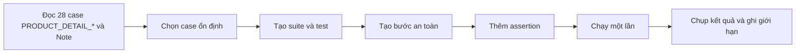

# Kế hoạch automation — Trang chi tiết sản phẩm CellphoneS

## 1. Mục tiêu và phạm vi

- **Nguồn test case:** `testcases/Group15_22130275_TrinhQuangThong.xlsx`, sheet `Trang chi tiết SP`, 28 ID theo quy ước PRODUCT_DETAIL_<FEATURE>_<ACTION>_<NN>. Bản đổi mã ID hiện tại: `testcases/Group15_22130275_TrinhQuangThong_v7.xlsx` (kết quả kiểm thử và ảnh giữ nguyên).
- **Môi trường:** Chrome, Ghost Inspector, viewport desktop và một lượt 390 × 844 px. Các lượt chạy thực tế dùng Chrome 153 ở 1280 × 800 px và 390 × 844 px, vùng chạy Northern Virginia (USA); trang sản phẩm iPhone 17 256GB.
- **Mục tiêu:** kiểm tra điều hướng và nội dung giao diện bằng assertion về text, phần tử và URL. Mỗi test tự mở Start URL, không dựa vào trạng thái của test khác.
- **Ngoài phạm vi chạy tự động:** thêm giỏ, mua ngay, checkout, đăng nhập CellphoneS, gửi biểu mẫu, URL chứa payload script. Bản gốc Excel vẫn giữ nguyên trạng thái thực thi trước đợt này; bản v4 ghi kết quả thật ở mục 8.

## 2. Chọn case

| Case | Ưu tiên | Automate | Lý do |
| --- | --- | --- | --- |
| PRODUCT_DETAIL_INFO_Open_01 | P1 | Yes | URL cố định, tiêu đề kiểm tra bằng text. |
| PRODUCT_DETAIL_INFO_View_01 | P1 | Yes | Kiểm tra sự hiện diện của tên, vùng giá, ảnh và thông số. |
| PRODUCT_DETAIL_INFO_View_02 | P1 | No | Giá bán/giá gốc thay đổi; assertion về quan hệ giá cần logic và locator đã kiểm chứng. |
| PRODUCT_DETAIL_INFO_View_03 | P1 | No | Trạng thái nhãn giảm giá có thể thay đổi theo niêm yết. |
| PRODUCT_DETAIL_VARIANT_Select_01 | P1 | Yes | Chọn 256GB, kiểm tra dấu chọn và dung lượng. |
| PRODUCT_DETAIL_VARIANT_Select_02 | P1 | Yes | Chọn 512GB, kiểm tra URL và tiêu đề. |
| PRODUCT_DETAIL_VARIANT_Switch_01 | P1 | Yes | Hai lần chuyển dung lượng có URL và tiêu đề rõ. |
| PRODUCT_DETAIL_VARIANT_Open_01 | P1 | Yes | URL 512GB và trường bộ nhớ là dữ liệu kiểm tra được. |
| PRODUCT_DETAIL_COLOR_Select_01 | P1 | Yes | Năm nhãn màu và dấu chọn quan sát được. |
| PRODUCT_DETAIL_COLOR_Select_02 | P1 | Yes | Màu đã chọn và ảnh chính có thể kiểm tra qua phần tử/thuộc tính sau khi xác nhận locator. |
| PRODUCT_DETAIL_VARIANT_Switch_02 | P2 | Yes | Đổi màu rồi dung lượng; kiểm tra URL và dấu chọn còn giữ. |
| PRODUCT_DETAIL_GALLERY_Select_01 | P2 | No | Thứ tự ảnh và tổng số ảnh `2 / 12` dễ thay đổi. |
| PRODUCT_DETAIL_GALLERY_Navigate_01 | P3 | No | Ảnh đầu/ảnh kế tiếp là nội dung thư viện dễ thay đổi. |
| PRODUCT_DETAIL_GALLERY_Navigate_02 | P3 | No | Trạng thái video/slide đầu phụ thuộc thư viện hiện tại. |
| PRODUCT_DETAIL_GALLERY_Open_01 | P3 | No | Bộ đếm `2 / 12` và chế độ xem ảnh lớn dễ đổi. |
| PRODUCT_DETAIL_INFO_View_04 | P2 | No | Khuyến mãi và lựa chọn mua biến động; không nhấn nút mua. |
| PRODUCT_DETAIL_INFO_Open_02 | P2 | Yes | Liên kết và vùng mô tả kiểm tra bằng phần tử/text. |
| PRODUCT_DETAIL_SPECS_View_01 | P1 | Yes | Tên các hàng thông số kiểm tra bằng text. |
| PRODUCT_DETAIL_SPECS_Open_01 | P3 | Yes | Nút `Xem tất cả` và tiêu đề cửa sổ có assertion rõ. |
| PRODUCT_DETAIL_SPECS_Switch_01 | P3 | Yes | Nhóm `Màn hình` và các tên trường hiển thị sau khi chọn. |
| PRODUCT_DETAIL_ACTION_Add_01 | P1 | No | Thao tác làm thay đổi giỏ hàng. |
| PRODUCT_DETAIL_ACTION_Buy_01 | P1 | No | Thao tác đi vào luồng giỏ/checkout. |
| PRODUCT_DETAIL_COLOR_Switch_01 | P1 | Yes | Chọn hai màu, kiểm tra dấu chọn và URL. |
| PRODUCT_DETAIL_ERROR_Open_01 | P1 | Yes | URL lỗi và text `Trang không tồn tại` kiểm tra được. |
| PRODUCT_DETAIL_ERROR_Security_01 | P2 | No | Request chứa payload bị HTTP 403 trước khi ứng dụng tải. |
| PRODUCT_DETAIL_COMPAT_Reload_01 | P2 | Yes | Reload và kiểm tra màu/URL sau tải lại. |
| PRODUCT_DETAIL_COMPAT_Navigate_01 | P2 | No | Back/Forward phụ thuộc lịch sử tab. |
| PRODUCT_DETAIL_COMPAT_View_01 | P2 | Yes | Ghost Inspector hỗ trợ viewport 390 × 844 px; assert nội dung và đối chiếu ảnh toàn trang để đánh giá bố cục. |

**Đối chiếu cột Note:** Bản gốc Excel từng ghi `Yes` cho bảy case giá, thư viện ảnh và khuyến mãi; kế hoạch chọn `No` vì giá, ưu đãi hoặc nội dung/thứ tự ảnh dễ đổi, và nhóm này chưa có locator/assertion bền vững. Bản v4 đã đồng bộ `Automate: No` cho đúng bảy case này; các case khác giữ lựa chọn cũ.

## 3. Cấu trúc Ghost Inspector

- **Suite:** `CellphoneS - Product Detail`.
- **Thiết lập chung:** Chrome 153, desktop 1280 × 800 px; riêng PRODUCT_DETAIL_COMPAT_View_01 dùng 390 × 844 px; mỗi test bắt đầu từ Start URL riêng và chạy độc lập. Ghost Inspector tự chờ phần tử trong từng bước, không thêm bước sleep cố định.
- **Assertion ưu tiên:** text/element present, URL contains. Chọn phần tử theo nhãn hiển thị hoặc thuộc tính ổn định sau khi record; tránh selector dựa trên thứ tự DOM và giá hiện tại.

| Test dự kiến | Case | Start URL | Bước và assertion tối thiểu |
| --- | --- | --- | --- |
| `PD_01_open_url` (trước đây PD_01) | PRODUCT_DETAIL_INFO_Open_01 | `/iphone-17-256gb.html` | Chờ tiêu đề sản phẩm; assert text `iPhone 17 256GB \| Chính hãng`. |
| `PD_05_PD_06_capacity_switch` (trước đây PD_05, PD_06) | PRODUCT_DETAIL_VARIANT_Select_01, PRODUCT_DETAIL_VARIANT_Select_02 | `/iphone-17-256gb.html` | Assert 256GB được chọn; chọn 512GB; assert URL chứa `/iphone-17-512gb.html` và tiêu đề 512GB. |
| `PD_09_select_color` (trước đây PD_09) | PRODUCT_DETAIL_COLOR_Select_01 | `/iphone-17-256gb.html` | Assert 5 tên màu; chọn một màu; assert ô màu được chọn. Không assert giá. |
| `PD_18_open_specs` (trước đây PD_18) | PRODUCT_DETAIL_SPECS_View_01 | `/iphone-17-256gb.html` | Bấm nút mở thông số; assert tiêu đề modal `Thông số kĩ thuật` và các tên trường `Hệ điều hành khi ra mắt`, `Chipset`, `Bộ nhớ trong`. |
| `PD_24_invalid_url` (trước đây PD_24) | PRODUCT_DETAIL_ERROR_Open_01 | `/san-pham-khong-ton-tai-qa-000.html` | Assert tiêu đề trang `Trang không tồn tại` cùng hai dòng thông báo lỗi đã quan sát. |

Các test đã được tạo thủ công trong trình chỉnh sửa bước của Ghost Inspector do Chrome hiện không cài Ghost Inspector recorder. Trước khi chạy, đã rà lại Start URL, selector và xác nhận test không bấm vào nút mua/giỏ.

## 4. Quy ước và dữ liệu

- Base URL: `https://cellphones.com.vn`.
- 256GB: `https://cellphones.com.vn/iphone-17-256gb.html`.
- 512GB: `https://cellphones.com.vn/iphone-17-512gb.html`.
- URL lỗi: `https://cellphones.com.vn/san-pham-khong-ton-tai-qa-000.html`.
- Năm màu ghi trong Excel: **Xanh Lá Xô Thơm, Đen, Trắng, Xanh Lam Khói, Tím Oải Hương**. Trước khi record, đối chiếu lại nhãn trên trang.
- Không ghi cứng giá, phần trăm giảm, ưu đãi, tồn kho hoặc số ảnh. Không dùng dữ liệu tài khoản CellphoneS.
- Tên test bắt đầu bằng ID; mỗi assertion có mô tả ngắn về điều được kiểm tra. Screenshot đặt tên theo test và thời điểm chạy khi có kết quả thật.

## 5. Rủi ro và cách xử lý

| Rủi ro | Cách xử lý |
| --- | --- |
| Giá/khuyến mãi đổi | Chỉ assert vùng hiện diện; không dùng giá hoặc nội dung khuyến mãi làm điều kiện pass. |
| Popup/banner che phần tử | Chờ UI ổn định; đóng popup bằng thao tác UI được record nếu xuất hiện. Không chặn script hay vượt cơ chế website. |
| HTTP 403/tường lửa/chặn bot | Dừng test bị ảnh hưởng, lưu ảnh và lỗi thật; không tìm cách vượt chặn. |
| Nội dung tải động | Chờ phần tử đích và dùng text/locator ổn định; tránh thời gian chờ cố định dài. |
| Giới hạn gói Ghost Inspector | Ghi giới hạn thực tế ở mục 8, dừng tạo/chạy khi hết quyền hoặc lượt. |
| Dữ liệu trình duyệt tồn tại | Mỗi test có Start URL; không dựa vào màu/giỏ đang lưu trong phiên duyệt. |

## 6. Checklist triển khai

- [x] Tạo suite `CellphoneS - Product Detail`.
- [x] Tạo 5 test trong bảng mục 3.
- [x] Tạo các bước thủ công trên Chrome; recorder chưa được cài.
- [x] Thêm và kiểm tra assertion text/element/URL.
- [x] Chạy mỗi test một lần.
- [x] Ghi pass/fail thực tế và URL kết quả.
- [x] Chụp màn hình kết quả vào `automation-plan/screenshots/`.
- [x] Kiểm tra các test Ghost Inspector không có bước thêm giỏ, checkout, đăng nhập hoặc gửi form; PRODUCT_DETAIL_ACTION_Add_01/PRODUCT_DETAIL_ACTION_Buy_01 được chạy thủ công riêng theo phạm vi người dùng cho phép.
- [x] Tạo và chạy thêm PRODUCT_DETAIL_INFO_View_01, PRODUCT_DETAIL_VARIANT_Switch_01, PRODUCT_DETAIL_VARIANT_Open_01, PRODUCT_DETAIL_COLOR_Select_02; lưu ảnh kết quả.
- [x] Tạo và chạy PRODUCT_DETAIL_VARIANT_Switch_02, PRODUCT_DETAIL_INFO_Open_02, PRODUCT_DETAIL_SPECS_Open_01, PRODUCT_DETAIL_SPECS_Switch_01, PRODUCT_DETAIL_COLOR_Switch_01, PRODUCT_DETAIL_COMPAT_Reload_01 ngày 23/10/2026; lưu ảnh pass/fail.
- [x] Ghi kết quả đã chạy vào bản sao Excel v4; giữ các case chưa chạy `Untested`.
- [x] Rà soát PRODUCT_DETAIL_VARIANT_Switch_02: lượt đầu `Failed` do locator sai; sửa bộ chọn đúng và chạy lại `Passed`, giữ ảnh hai lượt.
- [x] Chạy thủ công PRODUCT_DETAIL_INFO_View_02, PRODUCT_DETAIL_INFO_View_03, PRODUCT_DETAIL_GALLERY_Select_01, PRODUCT_DETAIL_GALLERY_Navigate_01, PRODUCT_DETAIL_GALLERY_Navigate_02, PRODUCT_DETAIL_GALLERY_Open_01 và PRODUCT_DETAIL_INFO_View_04, PRODUCT_DETAIL_COMPAT_Navigate_01; lưu ảnh và ghi rõ các expected không khớp.
- [x] Tạo và chạy PRODUCT_DETAIL_COMPAT_View_01 trên Ghost Inspector ở 390 × 844 px; kiểm tra ảnh toàn trang.
- [x] Chạy thủ công PRODUCT_DETAIL_ACTION_Add_01, PRODUCT_DETAIL_ACTION_Buy_01 sau khi người dùng cho phép thao tác Thêm vào giỏ và MUA NGAY; dừng tại trang giỏ, không checkout.
- [x] PRODUCT_DETAIL_ERROR_Security_01: đối chiếu lại ảnh chụp màn hình thủ công người dùng cung cấp ngày 19/10/2026; không truy cập lại URL payload ngày 23/10.
- [x] Kiểm tra lại PRODUCT_DETAIL_GALLERY_Select_01, PRODUCT_DETAIL_GALLERY_Navigate_01, PRODUCT_DETAIL_GALLERY_Open_01 trên Chrome; sửa Expected theo slide Video, bộ đếm ảnh và phản hồi Escape; chụp ảnh chỉ báo rõ ràng.
- [x] Chụp bổ sung toast PRODUCT_DETAIL_ACTION_Add_01, sau đó xóa sản phẩm thử; xóa biến thể PRODUCT_DETAIL_ACTION_Buy_01 đã thêm và khôi phục số giỏ về mức trước kiểm thử.
- [x] Lưu bản sao workbook v6, giữ v5 và đối chiếu thống kê PD với Test Report: 28 Passed, 0 Failed, 0 Untested.

## 7. Quy trình

## 8. Kết quả chạy và giới hạn

Đã tạo [suite `CellphoneS - Product Detail`](https://app.ghostinspector.com/suites/6ad976f131980945eaf18ac8) trong phiên Ghost Inspector đăng nhập tài khoản Quang Thông. Kiểm tra lại suite ngày 23/10/2026: **16 test đều hiển thị Passing**, bao phủ 17 mã PD vì một test ghép PRODUCT_DETAIL_VARIANT_Select_01 và PRODUCT_DETAIL_VARIANT_Select_02. PRODUCT_DETAIL_VARIANT_Switch_02 có lượt đầu `Failed` do locator sai, sau khi sửa bước #5 và chạy lại thì `Passed`; PRODUCT_DETAIL_COMPAT_View_01 cũng `Passed` ở lượt cuối sau khi sửa selector. Bản v5 ghi **25 Passed, 3 Failed, 0 Untested**. Ngày 23/10/2026, kiểm tra thủ công lại PRODUCT_DETAIL_GALLERY_Select_01, PRODUCT_DETAIL_GALLERY_Navigate_01, PRODUCT_DETAIL_GALLERY_Open_01 sau khi sửa Expected theo giao diện quan sát được; bản v6 ghi **28 Passed, 0 Failed, 0 Untested**. Kết quả Ghost Inspector chỉ xác nhận những assertion đã cấu hình; các case thư viện ảnh và PRODUCT_DETAIL_ACTION_Add_01/PRODUCT_DETAIL_ACTION_Buy_01 là kết quả kiểm tra thủ công.

| Test | Kết quả thật | Thời lượng | Bằng chứng |
| --- | --- | --- | --- |
| [`PD_01_open_url`](https://app.ghostinspector.com/tests/6ad9770c83736ca80bc771c6) (trước đây PD_01) | [Passed](https://app.ghostinspector.com/results/6ad9774a31980945eaf19340) | 0:31 | [Ảnh](screenshots/PD_01_pass_2026-10-22.png) |
| [`PD_05_PD_06_capacity_switch`](https://app.ghostinspector.com/tests/6ad9784283736ca80bc78db6) (trước đây PD_05, PD_06) | [Passed](https://app.ghostinspector.com/results/6ad9789083736ca80bc79278) | 0:35 | [Ảnh](screenshots/PD_05_PD_06_pass_2026-10-22.png) |
| [`PD_09_select_color`](https://app.ghostinspector.com/tests/6ad978e531980945eaf1ab63) (trước đây PD_09) | [Passed](https://app.ghostinspector.com/results/6ad9793231980945eaf1b017) | 0:32 | [Ảnh](screenshots/PD_09_pass_2026-10-22.png) |
| [`PD_18_open_specs`](https://app.ghostinspector.com/tests/6ad979b183736ca80bc8380a) (trước đây PD_18) | [Passed](https://app.ghostinspector.com/results/6ad97a2883736ca80bc83ffd) | 0:40 | [Ảnh](screenshots/PD_18_pass_2026-10-22.png) |
| [`PD_24_invalid_url`](https://app.ghostinspector.com/tests/6ad97a8f31980945eaf1ca72) (trước đây PD_24) | [Passed](https://app.ghostinspector.com/results/6ad97b4131980945eaf25d05) | 0:19 | [Ảnh](screenshots/PD_24_pass_2026-10-22.png) |
| [`PD_02_main_info`](https://app.ghostinspector.com/tests/6ada245f83736ca80bf0a96c) (trước đây PD_02) | [Passed](https://app.ghostinspector.com/results/6ada2b7183736ca80bf3874c) | Xem trang kết quả | [Ảnh](screenshots/PD_02_pass_2026-10-22.png) |
| [`PD_07_switch_capacity_back`](https://app.ghostinspector.com/tests/6ada329b83736ca80bf64a1b) (trước đây PD_07) | Passed trên trang test | 0:56 | [Ảnh](screenshots/PD_07_pass_2026-10-22.png) |
| [`PD_08_open_512gb_url`](https://app.ghostinspector.com/tests/6ad9f09883736ca80bdceed6) (trước đây PD_08) | [Passed](https://app.ghostinspector.com/results/6ad9f0d083736ca80bdcf8c3) | Xem trang kết quả | [Ảnh](screenshots/PD_08_pass_2026-10-22.png) |
| [`PD_10_color_main_image`](https://app.ghostinspector.com/tests/6ada376d83736ca80bf873b7) (trước đây PD_10) | Passed trên trang test | 0:33 | [Ảnh](screenshots/PD_10_pass_2026-10-22.png) |
| [`PD_11_keep_purple_on_512gb`](https://app.ghostinspector.com/tests/6ada43ec4824616f52084dd1) (trước đây PD_11) | **Passed** sau khi sửa locator; lượt đầu `Failed` do chọn sai phần tử | 0:32 lượt cuối | [Lượt cuối](screenshots/PD_11_pass_2026-10-23.png), [lượt đầu](screenshots/PD_11_fail_2026-10-23.png), [bước lỗi cũ](screenshots/PD_11_fail_step5_2026-10-23.png) |
| [`PD_17_open_description`](https://app.ghostinspector.com/tests/6ada461d83736ca80bfa859c) (trước đây PD_17) | Passed trên trang test | 0:34 | [Ảnh](screenshots/PD_17_pass_2026-10-23.png) |
| [`PD_19_expand_specifications`](https://app.ghostinspector.com/tests/6ada472583736ca80bfaa57e) (trước đây PD_19) | Passed trên trang test | 0:38 | [Ảnh](screenshots/PD_19_pass_2026-10-23.png) |
| [`PD_20_screen_specs_group`](https://app.ghostinspector.com/tests/6ada47d083736ca80bfab646) (trước đây PD_20) | Passed trên trang test | 0:46 | [Ảnh](screenshots/PD_20_pass_2026-10-23.png) |
| [`PD_23_switch_two_colors`](https://app.ghostinspector.com/tests/6ada48a983736ca80bfacac3) (trước đây PD_23) | Passed trên trang test | 0:35 | [Ảnh](screenshots/PD_23_pass_2026-10-23.png) |
| [`PD_26_reload_black_color`](https://app.ghostinspector.com/tests/6ada49354824616f5208fdd9) (trước đây PD_26) | Passed trên trang test | 0:40 | [Ảnh](screenshots/PD_26_pass_2026-10-23.png) |
| [`PD_28_mobile_390x844`](https://app.ghostinspector.com/tests/6ada502083736ca80bfb9b7e) (trước đây PD_28) | [Passed lượt cuối](https://app.ghostinspector.com/results/6ada516c4824616f520a23d5) | Xem trang kết quả | [Ảnh](screenshots/PD_28_pass_2026-10-23.png), [trang kết quả](screenshots/PD_28_GI_result_2026-10-23.png) |

### Đối chiếu bằng chứng từng case ngày 23/10/2026

`Passed (Ghost Inspector)` là trạng thái đã kiểm tra trực tiếp trong suite ở lần đối chiếu trước, không phải lượt chạy Ghost Inspector mới trong lần cập nhật v6. `Passed (thủ công)` dựa trên tương tác Chrome và ảnh đã lưu. Lần kiểm tra lại ngày 23/10/2026, PRODUCT_DETAIL_GALLERY_Select_01/PRODUCT_DETAIL_GALLERY_Open_01 có ảnh cho thấy `2 / 11`; PRODUCT_DETAIL_GALLERY_Navigate_01 có ảnh sau khi nhấn Next; PRODUCT_DETAIL_ACTION_Add_01 có ảnh toast và số giỏ tăng. PRODUCT_DETAIL_ERROR_Security_01 dựa trên ảnh người dùng cung cấp ngày 19/10/2026, không phải lượt chạy lại.

| Case | Kết quả | Cách kiểm tra | Có ảnh chụp? | Tên file ảnh |
| --- | --- | --- | --- | --- |
| PRODUCT_DETAIL_INFO_Open_01 | Passed | Ghost Inspector: `PD_01_open_url` (trước đây PD_01) | Có | `PD_01_pass_2026-10-22.png` |
| PRODUCT_DETAIL_INFO_View_01 | Passed | Ghost Inspector: `PD_02_main_info` (trước đây PD_02) | Có | `PD_02_pass_2026-10-22.png` |
| PRODUCT_DETAIL_INFO_View_02 | Passed | Thủ công ngày 23/10/2026 | Có | `PD_03_PD_04_PD_16_manual_2026-10-23.png` |
| PRODUCT_DETAIL_INFO_View_03 | Passed | Thủ công ngày 23/10/2026 | Có | `PD_03_PD_04_PD_16_manual_2026-10-23.png` |
| PRODUCT_DETAIL_VARIANT_Select_01 | Passed | Ghost Inspector: `PD_05_PD_06_capacity_switch` (trước đây PD_05, PD_06) | Có | `PD_05_PD_06_pass_2026-10-22.png` |
| PRODUCT_DETAIL_VARIANT_Select_02 | Passed | Ghost Inspector: `PD_05_PD_06_capacity_switch` (trước đây PD_05, PD_06) | Có | `PD_05_PD_06_pass_2026-10-22.png` |
| PRODUCT_DETAIL_VARIANT_Switch_01 | Passed | Ghost Inspector: `PD_07_switch_capacity_back` (trước đây PD_07) | Có | `PD_07_pass_2026-10-22.png` |
| PRODUCT_DETAIL_VARIANT_Open_01 | Passed | Ghost Inspector: `PD_08_open_512gb_url` (trước đây PD_08) | Có | `PD_08_pass_2026-10-22.png` |
| PRODUCT_DETAIL_COLOR_Select_01 | Passed | Ghost Inspector: `PD_09_select_color` (trước đây PD_09) | Có | `PD_09_pass_2026-10-22.png` |
| PRODUCT_DETAIL_COLOR_Select_02 | Passed | Ghost Inspector: `PD_10_color_main_image` (trước đây PD_10) | Có | `PD_10_pass_2026-10-22.png` |
| PRODUCT_DETAIL_VARIANT_Switch_02 | Passed | Ghost Inspector: `PD_11_keep_purple_on_512gb` (trước đây PD_11), lượt cuối | Có | `PD_11_pass_2026-10-23.png`; hai ảnh `PD_11_fail_2026-10-23.png`, `PD_11_fail_step5_2026-10-23.png` ghi lượt lỗi locator cũ |
| PRODUCT_DETAIL_GALLERY_Select_01 | Passed | Thủ công kiểm tra lại ngày 23/10/2026: chọn thumbnail 2, mở ảnh lớn thấy `2 / 11`; Expected mới không cố định tổng ảnh | Có | `PD_12_pass_2026-10-23.png` |
| PRODUCT_DETAIL_GALLERY_Navigate_01 | Passed | Thủ công kiểm tra lại ngày 23/10/2026 trên 512GB: slide đầu Video, Next đến ảnh sản phẩm đầu tiên | Có | `PD_13_pass_2026-10-23.png` |
| PRODUCT_DETAIL_GALLERY_Navigate_02 | Passed | Thủ công ngày 23/10/2026 | Có | `PD_14_manual_2026-10-23.png` |
| PRODUCT_DETAIL_GALLERY_Open_01 | Passed | Thủ công kiểm tra lại ngày 23/10/2026: ảnh lớn có `2 / 11`; Escape đóng ảnh lớn, hộp thoại video hiện bên dưới; đóng X để về trang | Có | `PD_15_pass_2026-10-23.png`; `PD_15_after_escape_2026-10-23.png` |
| PRODUCT_DETAIL_INFO_View_04 | Passed | Thủ công ngày 23/10/2026 | Có | `PD_03_PD_04_PD_16_manual_2026-10-23.png` |
| PRODUCT_DETAIL_INFO_Open_02 | Passed | Ghost Inspector: `PD_17_open_description` (trước đây PD_17) | Có | `PD_17_pass_2026-10-23.png` |
| PRODUCT_DETAIL_SPECS_View_01 | Passed | Ghost Inspector: `PD_18_open_specs` (trước đây PD_18) | Có | `PD_18_pass_2026-10-22.png` |
| PRODUCT_DETAIL_SPECS_Open_01 | Passed | Ghost Inspector: `PD_19_expand_specifications` (trước đây PD_19) | Có | `PD_19_pass_2026-10-23.png` |
| PRODUCT_DETAIL_SPECS_Switch_01 | Passed | Ghost Inspector: `PD_20_screen_specs_group` (trước đây PD_20) | Có | `PD_20_pass_2026-10-23.png` |
| PRODUCT_DETAIL_ACTION_Add_01 | Passed | Thủ công ngày 23/10/2026: màu Tím, giỏ 4 → 5; chụp lượt bổ sung màu Xanh Lá Xô Thơm, giỏ 4 → 5 và toast thành công; đã xóa sản phẩm thử | Có | `PD_21_pass_2026-10-23.png` |
| PRODUCT_DETAIL_ACTION_Buy_01 | Passed | Thủ công ngày 23/10/2026: lượt đầu màu Tím bị giới hạn số lượng; đổi sang màu Đen, MUA NGAY mở `/cart/`, tab Mua ngay và sản phẩm màu Đen hiển thị | Có | `PD_22_cart_manual_2026-10-23.png` |
| PRODUCT_DETAIL_COLOR_Switch_01 | Passed | Ghost Inspector: `PD_23_switch_two_colors` (trước đây PD_23) | Có | `PD_23_pass_2026-10-23.png` |
| PRODUCT_DETAIL_ERROR_Open_01 | Passed | Ghost Inspector: `PD_24_invalid_url` (trước đây PD_24) | Có | `PD_24_pass_2026-10-22.png` |
| PRODUCT_DETAIL_ERROR_Security_01 | Passed | Ảnh thủ công do người dùng cung cấp ngày 19/10/2026; bằng chứng lịch sử, không chạy lại | Có | `PD_25_user_manual_2026-10-19.png` |
| PRODUCT_DETAIL_COMPAT_Reload_01 | Passed | Ghost Inspector: `PD_26_reload_black_color` (trước đây PD_26) | Có | `PD_26_pass_2026-10-23.png` |
| PRODUCT_DETAIL_COMPAT_Navigate_01 | Passed | Thủ công ngày 23/10/2026 | Có | `PD_27_back_manual_2026-10-23.png`; `PD_27_forward_manual_2026-10-23.png` |
| PRODUCT_DETAIL_COMPAT_View_01 | Passed | Ghost Inspector: `PD_28_mobile_390x844` (trước đây PD_28), lượt cuối; ảnh toàn trang hỗ trợ đánh giá bố cục | Có | `PD_28_pass_2026-10-23.png`; `PD_28_GI_result_2026-10-23.png` |

**Ảnh đã có:** 28/28 case có ít nhất một file trong `automation-plan/screenshots/`. PRODUCT_DETAIL_GALLERY_Select_01 và PRODUCT_DETAIL_GALLERY_Open_01 có ảnh mới thấy rõ `2 / 11`; PRODUCT_DETAIL_ACTION_Add_01 có ảnh mới cho toast và giỏ tăng từ 4 lên 5. Sản phẩm được thêm trong PRODUCT_DETAIL_ACTION_Add_01/PRODUCT_DETAIL_ACTION_Buy_01 đã được dọn; giỏ về 4 sản phẩm như trước lúc kiểm thử.

### Giới hạn quan sát được

- Ghost Inspector recorder chưa được cài trên Chrome; các bước click và assertion được nhập thủ công trong giao diện Ghost Inspector. Vì vậy chưa kiểm chứng luồng record & playback bằng extension.
- Tài khoản hiển thị còn 3 ngày trial khi chạy đợt 23/10/2026. Chưa gặp captcha hoặc HTTP 403 trong các lượt Ghost Inspector ở bảng trên. URL chứa payload của PRODUCT_DETAIL_ERROR_Security_01 đã từng bị HTTP 403 khi kiểm tra thủ công và không được chạy trong bộ này.
- Trong lượt kiểm tra thủ công PRODUCT_DETAIL_ACTION_Buy_01, nút mua hiển thị `MUA NGAY` và mở `/cart/` đối với màu Đen. Tên nút, giá, ưu đãi và trạng thái mua có thể thay đổi theo thời điểm hoặc phiên truy cập. Bộ Ghost Inspector không tương tác nút này.
- PRODUCT_DETAIL_GALLERY_Open_01: Escape đóng trình xem ảnh lớn nhưng để lộ hộp thoại video; phải đóng hộp thoại video bằng X mới thấy lại trang chi tiết. Expected trong v6 mô tả đúng quan sát này; cần đánh giá riêng nếu đặc tả mong muốn Escape quay lại trang ngay.
- Ghost Inspector từng trả **Server Error** khi tải suite ngày 22/10/2026. Ngày 23/10/2026 suite tải lại được và sáu test còn thiếu đã chạy. Không áp dụng cách vượt chặn hoặc thay đổi quyền truy cập.
- PRODUCT_DETAIL_VARIANT_Switch_02: bước #2 xác nhận màu Tím được chọn trên 256GB (`product_id=112601`); bước #4 xác nhận đã mở trang 512GB. Lượt đầu, bước #5 tìm lớp `nuxt-link-exact-active` trên liên kết màu và báo `Element not found`. Kiểm tra trực tiếp DOM cho thấy trên 512GB dấu chọn nằm ở phần tử cha `li.item-variant.active`; sửa selector bước #5 theo cấu trúc này và lượt chạy lại **Passed**. Lượt đầu là lỗi thiết kế locator, không phải bằng chứng lỗi sản phẩm.
- Trang 512GB mở trực tiếp cũng có thể chọn sẵn màu Tím. Vì vậy PRODUCT_DETAIL_VARIANT_Switch_02 hiện chỉ xác nhận **trạng thái Tím sau chuyển trang**, chưa chứng minh cơ chế giữ lựa chọn cho một màu không mặc định. Nếu cần kiểm thử đúng tính giữ màu, nên thiết kế thêm dữ liệu màu khác và expected output tương ứng sau khi xác minh thủ công.
- PRODUCT_DETAIL_INFO_Open_02 xác nhận click và sự hiện diện của nội dung `#cpsContent`; test chưa assert trạng thái hiển thị của toàn bộ đoạn mô tả. PRODUCT_DETAIL_SPECS_Open_01 kiểm tra tiêu đề và hai nhóm đầu/cuối, chưa assert riêng cả tám nhóm. PRODUCT_DETAIL_COLOR_Switch_01 xác nhận liên kết/dấu chọn của hai màu; chưa assert riêng việc không có nhãn hết hàng. Các giới hạn độ phủ này không đổi kết quả Ghost Inspector đã ghi, nhưng cần xét khi đánh giá test case thủ công.
- `PRODUCT_DETAIL_VARIANT_Switch_01` xác nhận hai URL qua liên kết ở từng bước kết quả, cùng tiêu đề và ô dung lượng được chọn. `PRODUCT_DETAIL_COLOR_Select_02` xác nhận dấu chọn và ảnh qua assertion; URL `product_id=112602` hiện trong kết quả bước, chưa có assertion URL riêng. Test ghép PRODUCT_DETAIL_VARIANT_Select_01/PRODUCT_DETAIL_VARIANT_Select_02 và PRODUCT_DETAIL_SPECS_View_01 cũng chỉ chứng minh những bước/assertion đã lưu; cần rà lại độ phủ của toàn bộ Expected Output trước khi coi là hoàn tất test case thủ công.

## 9. Kiểm tra bổ sung ngày 23/10/2026

Bản v4 tại thời điểm kiểm tra bổ sung có **23 Passed, 3 Failed, 2 Untested** trên 28 case. `Failed` ở PRODUCT_DETAIL_GALLERY_Select_01, PRODUCT_DETAIL_GALLERY_Navigate_01, PRODUCT_DETAIL_GALLERY_Open_01 khi đó thể hiện expected trong Excel không khớp giao diện; chưa kết luận đó là lỗi sản phẩm. Ba expected đã được cập nhật và kiểm tra lại trong v6. Các case thủ công không được tính là lượt Ghost Inspector. Kết quả Ghost Inspector `Passed` chỉ xác nhận các assertion được cấu hình.

| Case | Cách chạy | Kết quả và quan sát | Minh chứng |
| --- | --- | --- | --- |
| PRODUCT_DETAIL_INFO_View_02, PRODUCT_DETAIL_INFO_View_03 | Chrome, kiểm tra thủ công | Passed: giá bán hiện diện, giá gốc gạch ngang; không có nhãn phần trăm giảm giá cạnh giá. | [Ảnh](screenshots/PD_03_PD_04_PD_16_manual_2026-10-23.png) |
| PRODUCT_DETAIL_GALLERY_Select_01, PRODUCT_DETAIL_GALLERY_Open_01 | Chrome, kiểm tra thủ công | Failed so với expected `2 / 12`: sau khi chọn ảnh thu nhỏ thứ hai, chế độ xem lớn hiện `1 / 11`; Escape đóng ảnh lớn. | [Ảnh thư viện](screenshots/PD_12_PD_15_gallery_manual_2026-10-23.png); bộ đếm được đọc trực tiếp từ `.spl-page` trong giao diện. |
| PRODUCT_DETAIL_GALLERY_Navigate_01 | Chrome, kiểm tra thủ công | Failed so với mô tả ảnh lưng → mặt trước: ảnh đầu là Video; Next chuyển đến ảnh sản phẩm đầu tiên. | [Ảnh](screenshots/PD_13_manual_2026-10-23.png) |
| PRODUCT_DETAIL_GALLERY_Navigate_02 | Chrome, kiểm tra thủ công | Passed: ở slide Video đầu tiên, Previous giữ nguyên ảnh và dấu chọn. | [Ảnh](screenshots/PD_14_manual_2026-10-23.png) |
| PRODUCT_DETAIL_INFO_View_04 | Chrome, kiểm tra thủ công | Passed: có vùng khuyến mãi, Trả góp 0%, MUA NGAY và nút giỏ; không bấm các nút mua. | [Ảnh](screenshots/PD_03_PD_04_PD_16_manual_2026-10-23.png) |
| PRODUCT_DETAIL_COMPAT_Navigate_01 | Chrome, kiểm tra thủ công | Passed: Back về 256GB màu Đen, `product_id=112595`; Forward tới 512GB màu Tím. | [Back](screenshots/PD_27_back_manual_2026-10-23.png), [Forward](screenshots/PD_27_forward_manual_2026-10-23.png) |
| PRODUCT_DETAIL_ERROR_Security_01 | Ảnh Chrome do người dùng cung cấp ngày 19/10/2026 | Passed theo expected ghi trong Excel: URL có chuỗi script dẫn đến trang HTTP 403, không thấy alert. Đây là **bằng chứng lịch sử**, không phải lượt chạy mới ngày 23/10. | [Ảnh](screenshots/PD_25_user_manual_2026-10-19.png) |
| [PD_28_mobile_390x844](https://app.ghostinspector.com/tests/6ada502083736ca80bfb9b7e) (trước đây PD_28) | Ghost Inspector, Chrome 153 ở 390 × 844 px | [Passed lượt cuối](https://app.ghostinspector.com/results/6ada516c4824616f520a23d5): body, tên sản phẩm, vùng màu, vùng khuyến mãi hiện diện. Ảnh toàn trang cho thấy ảnh, lựa chọn, khuyến mãi và thanh mua cố định nằm trong bố cục di động. | [Ảnh toàn trang](screenshots/PD_28_pass_2026-10-23.png), [trang kết quả](screenshots/PD_28_GI_result_2026-10-23.png) |

Lượt đầu của PRODUCT_DETAIL_COMPAT_View_01 [Failed](https://app.ghostinspector.com/results/6ada50bb4824616f5209e932) tại bước #1 do selector `#layout-mobile` không tồn tại trong DOM Ghost Inspector; ảnh vẫn cho thấy giao diện di động. Sau khi đổi assertion sang `body`/`h1`, lượt cuối Passed. Lượt Passed **chưa tự động đo chiều rộng tràn ngang hay vị trí thanh cố định**; kết luận về bố cục dựa trên ảnh toàn trang. Popup đăng ký khuyến mãi đã xuất hiện ở lượt đầu và có thể che thao tác nếu test click.

**Trạng thái trước khi người dùng cho phép thao tác giỏ/mua:** PRODUCT_DETAIL_ACTION_Add_01 và PRODUCT_DETAIL_ACTION_Buy_01 còn `Untested`; expected PRODUCT_DETAIL_ACTION_Add_01 ghi cứng 2 → 3 trong khi số giỏ khi đó là 4. Sau đó hai case đã được chạy thủ công và cập nhật ở mục 10. PRODUCT_DETAIL_ERROR_Security_01 đã được ghi `Passed` theo ảnh thủ công ngày 19/10/2026; không kết luận ứng dụng đã xử lý payload vì trang bị chặn HTTP 403 trước khi tải.

**Đã bảo trì trong v6:** PRODUCT_DETAIL_GALLERY_Select_01 và PRODUCT_DETAIL_GALLERY_Open_01 đã được kiểm tra lại với bộ đếm hiển thị rõ `2 / 11`; PRODUCT_DETAIL_GALLERY_Navigate_01 được kiểm tra lại từ slide Video trên 512GB. Expected và Procedure được sửa theo đúng thao tác đã quan sát, không ghi cứng tổng số ảnh. Các ảnh cũ và kết quả v4/v5 ở bảng này là lịch sử kiểm thử, không phải trạng thái hiện tại.

## 10. Chạy thủ công PRODUCT_DETAIL_ACTION_Add_01 và PRODUCT_DETAIL_ACTION_Buy_01 ngày 23/10/2026

Người dùng cho phép bấm Thêm vào giỏ và MUA NGAY, với giới hạn dừng trước checkout. Không chạy Ghost Inspector cho hai case này.

| Case | Quan sát trực tiếp | Kết quả ghi vào Excel | Minh chứng |
| --- | --- | --- | --- |
| PRODUCT_DETAIL_ACTION_Add_01 | Trên iPhone 17 256GB màu Tím Oải Hương, biểu tượng giỏ tăng 4 → 5; toast ghi “Thêm vào giỏ hàng thành công”. Lượt chụp bổ sung với màu Xanh Lá Xô Thơm cũng tăng 4 → 5 và có cùng toast. | Passed sau khi đổi expected từ số cố định 2 → 3 sang quy tắc tăng thêm 1. | [Ảnh lượt bổ sung](screenshots/PD_21_pass_2026-10-23.png) |
| PRODUCT_DETAIL_ACTION_Buy_01 | Lượt đầu bấm MUA NGAY trên màu Tím vừa thêm ở PRODUCT_DETAIL_ACTION_Add_01: website báo đã đạt số lượng tối đa và mở hộp thoại tư vấn B2B, không chuyển trang. Đóng hộp thoại, chọn iPhone 17 256GB màu Đen rồi bấm MUA NGAY: chuyển đến `https://cellphones.com.vn/cart/`; trang có “Giỏ hàng của bạn”, tab “Mua ngay” được chọn và sản phẩm màu Đen hiển thị. | Passed với dữ liệu màu Đen và tiền đề giỏ chưa đạt giới hạn cho biến thể đó. | [Ảnh trang giỏ](screenshots/PD_22_cart_manual_2026-10-23.png) |

Đã dừng tại trang giỏ. Không chọn bước MUA NGAY trong giỏ, không nhập thông tin giao hàng và không đặt hàng. Lượt đầu PRODUCT_DETAIL_ACTION_Buy_01 bị giới hạn bởi trạng thái giỏ, không được tính là lỗi sản phẩm. Sau kiểm thử, đã xóa biến thể màu Đen của PRODUCT_DETAIL_ACTION_Buy_01, giảm màu Tím từ 3 về 2 và xóa biến thể màu Xanh Lá Xô Thơm dùng để chụp PRODUCT_DETAIL_ACTION_Add_01; giỏ hiển thị lại 4 sản phẩm.
