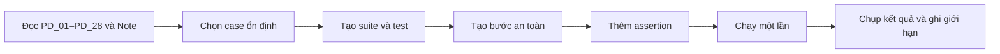

# Kế hoạch automation — Trang chi tiết sản phẩm CellphoneS

## 1. Mục tiêu và phạm vi

- **Nguồn test case:** `testcases/Group15_22130275_TrinhQuangThong.xlsx`, sheet `Trang chi tiết SP`, PD_01–PD_28. Cột `Note` là nhận định ban đầu về khả năng tự động hóa; bảng dưới là lựa chọn triển khai cho Ghost Inspector.
- **Môi trường:** Chrome, Ghost Inspector, viewport desktop. Các lượt chạy thực tế dùng Chrome 153 ở 1280 × 800 px, vùng chạy Northern Virginia (USA); trang sản phẩm iPhone 17 256GB.
- **Mục tiêu:** kiểm tra điều hướng và nội dung giao diện bằng assertion về text, phần tử và URL. Mỗi test tự mở Start URL, không dựa vào trạng thái của test khác.
- **Ngoài phạm vi chạy tự động:** thêm giỏ, mua ngay, checkout, đăng nhập CellphoneS, gửi biểu mẫu, URL chứa payload script. Cột `Result` của Excel vẫn là `Untested`; kết quả chạy Ghost Inspector được ghi riêng ở mục 8.

## 2. Chọn case

| Case | Ưu tiên | Automate | Lý do |
| --- | --- | --- | --- |
| PD_01 | P1 | Yes | URL cố định, tiêu đề kiểm tra bằng text. |
| PD_02 | P1 | Yes | Kiểm tra sự hiện diện của tên, vùng giá, ảnh và thông số. |
| PD_03 | P1 | No | Giá bán/giá gốc thay đổi; assertion về quan hệ giá cần logic và locator đã kiểm chứng. |
| PD_04 | P1 | No | Trạng thái nhãn giảm giá có thể thay đổi theo niêm yết. |
| PD_05 | P1 | Yes | Chọn 256GB, kiểm tra dấu chọn và dung lượng. |
| PD_06 | P1 | Yes | Chọn 512GB, kiểm tra URL và tiêu đề. |
| PD_07 | P1 | Yes | Hai lần chuyển dung lượng có URL và tiêu đề rõ. |
| PD_08 | P1 | Yes | URL 512GB và trường bộ nhớ là dữ liệu kiểm tra được. |
| PD_09 | P1 | Yes | Năm nhãn màu và dấu chọn quan sát được. |
| PD_10 | P1 | Yes | Màu đã chọn và ảnh chính có thể kiểm tra qua phần tử/thuộc tính sau khi xác nhận locator. |
| PD_11 | P2 | Yes | Đổi màu rồi dung lượng; kiểm tra URL và dấu chọn còn giữ. |
| PD_12 | P2 | No | Thứ tự ảnh và tổng số ảnh `2 / 12` dễ thay đổi. |
| PD_13 | P3 | No | Ảnh đầu/ảnh kế tiếp là nội dung thư viện dễ thay đổi. |
| PD_14 | P3 | No | Trạng thái video/slide đầu phụ thuộc thư viện hiện tại. |
| PD_15 | P3 | No | Bộ đếm `2 / 12` và chế độ xem ảnh lớn dễ đổi. |
| PD_16 | P2 | No | Khuyến mãi và lựa chọn mua biến động; không nhấn nút mua. |
| PD_17 | P2 | Yes | Liên kết và vùng mô tả kiểm tra bằng phần tử/text. |
| PD_18 | P1 | Yes | Tên các hàng thông số kiểm tra bằng text. |
| PD_19 | P3 | Yes | Nút `Xem tất cả` và tiêu đề cửa sổ có assertion rõ. |
| PD_20 | P3 | Yes | Nhóm `Màn hình` và các tên trường hiển thị sau khi chọn. |
| PD_21 | P1 | No | Thao tác làm thay đổi giỏ hàng. |
| PD_22 | P1 | No | Thao tác đi vào luồng giỏ/checkout. |
| PD_23 | P1 | Yes | Chọn hai màu, kiểm tra dấu chọn và URL. |
| PD_24 | P1 | Yes | URL lỗi và text `Trang không tồn tại` kiểm tra được. |
| PD_25 | P2 | No | Request chứa payload bị HTTP 403 trước khi ứng dụng tải. |
| PD_26 | P2 | Yes | Reload và kiểm tra màu/URL sau tải lại. |
| PD_27 | P2 | No | Back/Forward phụ thuộc lịch sử tab. |
| PD_28 | P2 | No | Bài test 390 × 844 px cần cấu hình viewport riêng và đối chiếu bố cục. |

**Khác với cột Note của Excel:** Excel ghi `Yes` cho PD_03, PD_04, PD_12–PD_16; kế hoạch chọn `No` vì giá, ưu đãi hoặc nội dung/thứ tự ảnh dễ đổi, và nhóm này chưa có locator/assertion bền vững. Các case còn lại giữ lựa chọn theo Excel. Đây là quyết định ưu tiên triển khai, không sửa workbook.

## 3. Cấu trúc Ghost Inspector

- **Suite:** `CellphoneS - Product Detail`.
- **Thiết lập chung:** Chrome 153, desktop 1280 × 800 px theo kết quả chạy; mỗi test bắt đầu từ Start URL riêng và chạy độc lập. Ghost Inspector tự chờ phần tử trong từng bước, không thêm bước sleep cố định.
- **Assertion ưu tiên:** text/element present, URL contains. Chọn phần tử theo nhãn hiển thị hoặc thuộc tính ổn định sau khi record; tránh selector dựa trên thứ tự DOM và giá hiện tại.

| Test dự kiến | Case | Start URL | Bước và assertion tối thiểu |
| --- | --- | --- | --- |
| `PD_01_open_url` | PD_01 | `/iphone-17-256gb.html` | Chờ tiêu đề sản phẩm; assert text `iPhone 17 256GB \| Chính hãng`. |
| `PD_05_PD_06_capacity_switch` | PD_05, PD_06 | `/iphone-17-256gb.html` | Assert 256GB được chọn; chọn 512GB; assert URL chứa `/iphone-17-512gb.html` và tiêu đề 512GB. |
| `PD_09_select_color` | PD_09 | `/iphone-17-256gb.html` | Assert 5 tên màu; chọn một màu; assert ô màu được chọn. Không assert giá. |
| `PD_18_open_specs` | PD_18 | `/iphone-17-256gb.html` | Bấm nút mở thông số; assert tiêu đề modal `Thông số kĩ thuật` và các tên trường `Hệ điều hành khi ra mắt`, `Chipset`, `Bộ nhớ trong`. |
| `PD_24_invalid_url` | PD_24 | `/san-pham-khong-ton-tai-qa-000.html` | Assert tiêu đề trang `Trang không tồn tại` cùng hai dòng thông báo lỗi đã quan sát. |

Các test đã được tạo thủ công trong trình chỉnh sửa bước của Ghost Inspector do Chrome hiện không cài Ghost Inspector recorder. Trước khi chạy, đã rà lại Start URL, selector và xác nhận test không bấm vào nút mua/giỏ.

## 4. Quy ước và dữ liệu

- Base URL: `https://cellphones.com.vn`.
- 256GB: `https://cellphones.com.vn/iphone-17-256gb.html`.
- 512GB: `https://cellphones.com.vn/iphone-17-512gb.html`.
- URL lỗi: `https://cellphones.com.vn/san-pham-khong-ton-tai-qa-000.html`.
- Năm màu ghi trong Excel: **Xanh Lá Xô Thơm, Đen, Trắng, Xanh Lam Khói, Tím Oải Hương**. Trước khi record, đối chiếu lại nhãn trên trang.
- Không ghi cứng giá, phần trăm giảm, ưu đãi, tồn kho hoặc số ảnh. Không dùng dữ liệu tài khoản CellphoneS.
- Tên test bắt đầu bằng ID; mỗi assertion có mô tả ngắn về điều được kiểm tra. Screenshot đặt tên theo test và thời điểm chạy khi có kết quả thật.

## 5. Rủi ro và cách xử lý

| Rủi ro | Cách xử lý |
| --- | --- |
| Giá/khuyến mãi đổi | Chỉ assert vùng hiện diện; không dùng giá hoặc nội dung khuyến mãi làm điều kiện pass. |
| Popup/banner che phần tử | Chờ UI ổn định; đóng popup bằng thao tác UI được record nếu xuất hiện. Không chặn script hay vượt cơ chế website. |
| HTTP 403/tường lửa/chặn bot | Dừng test bị ảnh hưởng, lưu ảnh và lỗi thật; không tìm cách vượt chặn. |
| Nội dung tải động | Chờ phần tử đích và dùng text/locator ổn định; tránh thời gian chờ cố định dài. |
| Giới hạn gói Ghost Inspector | Ghi giới hạn thực tế ở mục 8, dừng tạo/chạy khi hết quyền hoặc lượt. |
| Dữ liệu trình duyệt tồn tại | Mỗi test có Start URL; không dựa vào màu/giỏ đang lưu trong phiên duyệt. |

## 6. Checklist triển khai

- [x] Tạo suite `CellphoneS - Product Detail`.
- [x] Tạo 5 test trong bảng mục 3.
- [x] Tạo các bước thủ công trên Chrome; recorder chưa được cài.
- [x] Thêm và kiểm tra assertion text/element/URL.
- [x] Chạy mỗi test một lần.
- [x] Ghi pass/fail thực tế và URL kết quả.
- [x] Chụp màn hình kết quả vào `automation-plan/screenshots/`.
- [x] Kiểm tra không có bước thêm giỏ, checkout, đăng nhập hoặc gửi form.

## 7. Quy trình

## 8. Kết quả chạy và giới hạn

Đã tạo [suite `CellphoneS - Product Detail`](https://app.ghostinspector.com/suites/6ad976f131980945eaf18ac8) trong phiên Ghost Inspector đăng nhập tài khoản Quang Thông. Mỗi test được chạy **một lần** ngày 22/10/2026; cả 5 kết quả được Ghost Inspector ghi **Passed**. Các kết quả này chỉ xác nhận các assertion đã cấu hình, không thay thế trạng thái `Untested` trong Excel.

| Test | Kết quả thật | Thời lượng | Bằng chứng |
| --- | --- | --- | --- |
| [`PD_01_open_url`](https://app.ghostinspector.com/tests/6ad9770c83736ca80bc771c6) | [Passed](https://app.ghostinspector.com/results/6ad9774a31980945eaf19340) | 0:31 | [Ảnh](screenshots/PD_01_pass_2026-10-22.png) |
| [`PD_05_PD_06_capacity_switch`](https://app.ghostinspector.com/tests/6ad9784283736ca80bc78db6) | [Passed](https://app.ghostinspector.com/results/6ad9789083736ca80bc79278) | 0:35 | [Ảnh](screenshots/PD_05_PD_06_pass_2026-10-22.png) |
| [`PD_09_select_color`](https://app.ghostinspector.com/tests/6ad978e531980945eaf1ab63) | [Passed](https://app.ghostinspector.com/results/6ad9793231980945eaf1b017) | 0:32 | [Ảnh](screenshots/PD_09_pass_2026-10-22.png) |
| [`PD_18_open_specs`](https://app.ghostinspector.com/tests/6ad979b183736ca80bc8380a) | [Passed](https://app.ghostinspector.com/results/6ad97a2883736ca80bc83ffd) | 0:40 | [Ảnh](screenshots/PD_18_pass_2026-10-22.png) |
| [`PD_24_invalid_url`](https://app.ghostinspector.com/tests/6ad97a8f31980945eaf1ca72) | [Passed](https://app.ghostinspector.com/results/6ad97b4131980945eaf25d05) | 0:19 | [Ảnh](screenshots/PD_24_pass_2026-10-22.png) |

### Giới hạn quan sát được

- Ghost Inspector recorder chưa được cài trên Chrome; các bước click và assertion được nhập thủ công trong giao diện Ghost Inspector. Vì vậy chưa kiểm chứng luồng record & playback bằng extension.
- Tài khoản hiển thị còn 4 ngày trial tại thời điểm tạo test. Chưa gặp captcha hoặc HTTP 403 trong năm lượt chạy trên. URL chứa payload của PD_25 đã từng bị HTTP 403 khi kiểm tra thủ công và không được chạy trong bộ này.
- Trang sản phẩm hiện hiển thị nút `ĐẶT TRƯỚC NGAY` trong phiên Chrome, khác tên nút mua trong một số test case Excel; bộ automation không tương tác nút này. Giá, ưu đãi và trạng thái mua có thể tiếp tục thay đổi.
