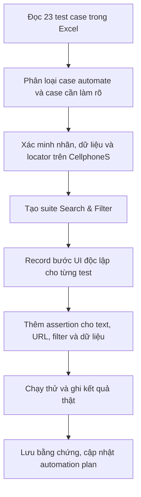

# Kế hoạch Automation Test — Search & Filter Products trên CellphoneS

## 1. Mục tiêu và phạm vi

- **Dự án:** CellphoneS E2E Testing.
- **Project code:** `CELLPHONES`.
- **Nguồn test case:** `Group15_22130326_PhamVuTienVinh.xlsx`, sheet `Search_filter`, gồm 23 test case từ `TC_Search_01` đến `TC_Filter_23`.
- **Website kiểm thử:** [https://cellphones.com.vn/](https://cellphones.com.vn/).
- **Trang danh mục điện thoại:** [https://cellphones.com.vn/mobile.html](https://cellphones.com.vn/mobile.html).
- **Công cụ automation dự kiến:** Ghost Inspector.
- **Môi trường theo tài liệu gốc:** website CellphoneS trên môi trường production. Cấu hình chạy đề xuất là Chrome ở desktop 1280 × 800 px; cần ghi lại phiên bản trình duyệt thực tế khi chạy. Có thể bổ sung viewport 390 × 844 px nếu cần kiểm tra responsive.
- **Mục tiêu:** tự động kiểm tra tìm kiếm theo từ khóa, gợi ý tìm kiếm, trạng thái không có kết quả, bộ lọc thương hiệu/giá/tình trạng, kết hợp nhiều bộ lọc, thao tác xóa bộ lọc và chọn khu vực.
- **Nguyên tắc:** mỗi test nên tự thiết lập trạng thái cần thiết để chạy độc lập. Với dữ liệu thay đổi theo thời gian như giá, khuyến mãi, tồn kho và danh sách sản phẩm, không cố định tên sản phẩm hoặc giá cụ thể nếu không cần thiết.
- **Ngoài phạm vi:** đăng nhập, đặt hàng, thanh toán, gửi thông tin cá nhân, thao tác mua hàng và bất kỳ bước checkout nào. Các test chỉ kiểm tra tìm kiếm, bộ lọc và điều hướng liên quan.

> **Lưu ý về trạng thái:** file Excel có ghi kết quả `Passed` cho 23/23 test case. Đây là kết quả hiện có trong workbook nguồn, không tự động chứng minh các test đó đã được tạo và chạy bằng Ghost Inspector. Tài liệu này là kế hoạch triển khai; trạng thái chạy automation chỉ được cập nhật sau khi có kết quả thực tế từ công cụ.

## 2. Lựa chọn test case

Quyết định automate dưới đây là **đề xuất cho bộ automation**, dựa trên độ ổn định của dữ liệu và khả năng tạo assertion. Ưu tiên P1/P2 cũng là mức đề xuất cho kế hoạch này.

| Test case trong Excel | Ưu tiên | Automate đề xuất | Lý do |
| --- | --- | --- | --- |
| `TC_Search_01: Search_ValidKeyword` | P1 | Yes | Luồng tìm kiếm cơ bản; có thể kiểm tra khu vực kết quả và sản phẩm theo từ khóa. |
| `TC_Search_02: Search_UnaccentedKeyword` | P1 | Yes | Kiểm tra tìm kiếm tiếng Việt/nhãn không dấu với kết quả có dấu tương ứng. |
| `TC_Search_03: Search_Autocomplete_ShowSuggestions` | P1 | Yes | Có thể kiểm tra dropdown gợi ý xuất hiện khi gõ `Macb`; không cố định toàn bộ danh sách gợi ý. |
| `TC_Search_04: Search_TypoKeyword_ShowSuggestions` | P2 | No | Kết quả sửa lỗi chính tả hoặc gợi ý của `iphne` có thể thay đổi; expected cần xác nhận rõ trước khi tự động hóa. |
| `TC_Search_05: Search_BrandKeyword` | P1 | Yes | Tìm kiếm theo thương hiệu; kiểm tra danh sách kết quả thay vì cố định số lượng hoặc thứ tự sản phẩm. |
| `TC_Search_06: Search_CategoryKeyword` | P1 | Yes | Từ khóa danh mục `Tai nghe Bluetooth` có thể kiểm tra qua khu vực kết quả và nhãn phù hợp. |
| `TC_Search_07: Search_Product_specification` | P2 | No | Việc lập chỉ mục thông số `amoled 120hz` phụ thuộc dữ liệu sản phẩm và nội dung website; cần xác nhận điều kiện kết quả ổn định. |
| `TC_Search_08: Search_InvalidKeyword_ShowEmptyMessage` | P1 | Yes | Có expected rõ cho thông báo không có kết quả; không cần kiểm tra các sản phẩm gợi ý thay thế cụ thể. |
| `TC_Search_09: Search_EmptyInput_NoAction` | P1 | Yes | Có thể so sánh URL trước/sau và xác nhận giao diện vẫn hoạt động khi ô tìm kiếm trống. |
| `TC_Search_10: Search_SpecialCharacters` | P2 | Yes | Có thể kiểm tra hệ thống xử lý chuỗi ký tự đặc biệt an toàn và giao diện vẫn hoạt động. |
| `TC_Search_11: Search_LongString_TruncatedOrHandled` | P2 | No | Expected hiện cho phép nhiều cách xử lý (giới hạn input hoặc cắt chuỗi) nhưng chưa định nghĩa ngưỡng và kết quả chính xác. |
| `TC_Filter_12: Filter_ByBrand` | P1 | Yes | Bộ lọc thương hiệu là chức năng cốt lõi; có thể kiểm tra tag bộ lọc và thương hiệu của các sản phẩm hiển thị. |
| `TC_Filter_13: Filter_ByPriceRange` | P1 | Yes | Có thể kiểm tra khoảng giá 10–15 triệu bằng cách đọc giá bán trên card và so sánh theo khoảng, sau khi xác nhận locator. |
| `TC_Filter_14: Filter_MultiCriteria` | P1 | Yes | Kiểm tra kết hợp Samsung, sắp xếp giá thấp–cao và tình trạng hàng mới; cần assertion cho các điều kiện đang áp dụng và thứ tự giá. |
| `TC_Filter_15: Search_location_by_Filter` | P2 | Yes | Kiểm tra ô nhập khu vực, gợi ý khi gõ `Hà`, chọn Hà Nội và xác nhận khu vực/kết quả được cập nhật. Không cố định giá hay tồn kho. |
| `TC_Filter_16: Filter_ClearSingleFilter` | P1 | Yes | Có thể xác minh một tag bị xóa trong khi bộ lọc Samsung vẫn được giữ lại. Test sẽ tự tạo trạng thái ban đầu. |
| `TC_Filter_17: Filter_NoResultMatch_ShowEmptyMessage` | P2 | No | Tổ hợp Samsung + hàng mới + sạc không dây có thể có kết quả khi danh mục thay đổi; phải xác minh một bộ dữ liệu không có kết quả trước khi dùng làm assertion cố định. |
| `TC_Search_18: Search_history_suggestion` | P2 | Yes | Có thể tìm một từ khóa rồi mở lại ô tìm kiếm trong cùng test để kiểm tra lịch sử; không phụ thuộc vào dữ liệu từ lần chạy trước. |
| `TC_Filter_19: Filter_ClearAllFilters` | P1 | Yes | Có thể tự áp dụng ba bộ lọc, bấm xóa tất cả và xác minh các tag/điều kiện được gỡ bỏ. |
| `TC_Filter_20: Filter_CustomPriceRange_Validation` | P2 | No | Min = 20.000.000 lớn hơn max = 5.000.000 nhưng expected chưa quy định rõ hệ thống phải hoán đổi giá trị, báo lỗi hay chặn áp dụng. |
| `TC_Filter_21: Filter_ByProductCondition` | P2 | Yes | Có thể kiểm tra chọn `Hàng cũ giá rẻ` và trạng thái/lựa chọn bộ lọc tương ứng; không cố định sản phẩm cụ thể. |
| `TC_Filter_22: Filter_trade_in` | P2 | Yes | Có thể kiểm tra điều hướng tới khu vực `Thu cũ đổi mới` và sự hiện diện của vùng danh sách/bộ lọc. |
| `TC_Filter_23: Filter_ByLocation` | P2 | Yes | Có thể chọn khu vực từ danh sách có sẵn và kiểm tra khu vực đang chọn cùng vùng kết quả sau cập nhật. |

**Tổng đề xuất:** 18 test case tự động hóa; 5 test case tạm giữ để làm rõ expected hoặc dữ liệu (`TC_Search_04`, `TC_Search_07`, `TC_Search_11`, `TC_Filter_17`, `TC_Filter_20`). Các case tạm giữ vẫn có thể được chạy thủ công cho đến khi điều kiện kiểm tra đủ rõ và ổn định.

## 3. Cấu trúc suite và test dự kiến trong Ghost Inspector

### 3.1. Cấu hình chung

- **Suite name đề xuất:** `CellphoneS - Search & Filter`.
- **Browser:** Chrome; ghi nhận phiên bản thực tế khi chạy.
- **Viewport chính:** 1280 × 800 px (đề xuất).
- **Start URL:**
  - Trang chủ tìm kiếm: `https://cellphones.com.vn/`
  - Danh mục điện thoại: `https://cellphones.com.vn/mobile.html`
- Mỗi test mở Start URL riêng. Những case có phụ thuộc trạng thái sẽ tự tạo trạng thái đó ngay trong cùng test, không dựa vào thứ tự chạy suite.
- Ưu tiên assertion về phần tử hiển thị, nội dung text, tag bộ lọc, URL và dữ liệu giá sau khi đã xác minh locator. Tránh selector dựa trên thứ tự DOM hoặc class CSS có thể thay đổi.
- Đối với autocomplete, chỉ kiểm tra dropdown và gợi ý liên quan xuất hiện; không khóa test vào toàn bộ thứ tự gợi ý.
- Đối với dữ liệu động, xác minh quy tắc (ví dụ giá trong khoảng 10–15 triệu, giá sắp xếp tăng dần) thay vì cố định tên sản phẩm hoặc giá của từng model.

### 3.2. Test dự kiến và assertion tối thiểu

| Tên test dự kiến | Case nguồn | Start URL | Các bước chính và assertion tối thiểu |
| --- | --- | --- | --- |
| `SF_Search_01_valid_keyword` | `TC_Search_01` | `/` | Nhập `iPhone 15 Pro Max 256GB`, nhấn Enter; xác nhận vùng kết quả xuất hiện và kết quả phù hợp với từ khóa. Nếu sản phẩm không còn được bán/index, cập nhật dữ liệu test trước khi kết luận lỗi. |
| `SF_Search_02_unaccented_keyword` | `TC_Search_02` | `/` | Nhập `samsung s24 ultra`; xác nhận kết quả có tên Samsung Galaxy S24 Ultra hoặc kết quả tương ứng có dấu. |
| `SF_Search_03_autocomplete` | `TC_Search_03` | `/` | Gõ `Macb` nhưng không Enter; xác nhận dropdown gợi ý hiển thị và có ít nhất một gợi ý liên quan đến `MacBook`. |
| `SF_Search_05_brand_keyword` | `TC_Search_05` | `/` | Nhập `Apple`, nhấn Enter; xác nhận vùng kết quả hiện diện và có kết quả liên quan thương hiệu Apple. Không cố định số lượng sản phẩm. |
| `SF_Search_06_category_keyword` | `TC_Search_06` | `/` | Nhập `Tai nghe Bluetooth`, nhấn Enter; xác nhận trang kết quả mở và danh sách/nhãn phù hợp với nhóm tai nghe Bluetooth. |
| `SF_Search_08_no_result` | `TC_Search_08` | `/` | Nhập `xyz123456789`, nhấn Enter; xác nhận thông báo `Không có kết quả bạn cần tìm`. Không assertion vào danh sách gợi ý sản phẩm khác. |
| `SF_Search_09_empty_input` | `TC_Search_09` | `/` | Để trống ô tìm kiếm, ghi nhận URL, bấm biểu tượng tìm kiếm; xác nhận không điều hướng ngoài dự kiến và trang vẫn hoạt động. |
| `SF_Search_10_special_characters` | `TC_Search_10` | `/` | Nhập `@#$%^&*()` rồi Enter; xác nhận trang phản hồi an toàn, không lỗi giao diện và hiển thị trạng thái kết quả phù hợp. Xác minh expected thực tế trước khi record assertion text cuối cùng. |
| `SF_Filter_12_by_brand` | `TC_Filter_12` | `/mobile.html` | Mở bộ lọc thương hiệu, chọn Samsung; xác nhận tag/điều kiện Samsung được áp dụng và các card hiển thị phù hợp thương hiệu đã chọn. Excel viết `Sámung`; cần xác nhận nhãn chính xác trên website. |
| `SF_Filter_13_price_range` | `TC_Filter_13` | `/mobile.html` | Chọn giá `Từ 10 - 15 triệu`; xác nhận filter được áp dụng. Sau khi xác minh locator của giá bán, kiểm tra các giá được hiển thị thuộc khoảng 10.000.000–15.000.000 đồng; không dùng giá cố định. |
| `SF_Filter_14_multi_criteria` | `TC_Filter_14` | `/mobile.html` | Chọn Samsung, chọn sắp xếp giá thấp–cao và chọn Hàng mới; xác nhận các điều kiện/tag vẫn được áp dụng. Kiểm tra thương hiệu/tình trạng trên card và giá tăng dần sau khi xác minh được cách đọc giá ổn định. |
| `SF_Filter_15_location_search` | `TC_Filter_15` | `/mobile.html` | Mở chọn tỉnh/thành phố, nhập `Hà`, xác nhận gợi ý xuất hiện; chọn `Hà Nội`, xác nhận khu vực đang chọn là Hà Nội và vùng sản phẩm vẫn tải được. Không assert giá/khuyến mãi/tồn kho cụ thể. |
| `SF_Filter_16_clear_single` | `TC_Filter_16` | `/mobile.html` | Trong cùng test, chọn Samsung rồi Hàng mới; bấm dấu X trên tag Hàng mới; xác nhận tag Hàng mới mất nhưng tag Samsung vẫn còn và danh sách kết quả vẫn hiện diện. |
| `SF_Search_18_history_suggestion` | `TC_Search_18` | `/` | Tìm `iphone 18`, sau đó mở lại ô tìm kiếm trong cùng phiên; xác nhận từ khóa xuất hiện trong phần lịch sử/gợi ý và có thể chọn lại. Không phụ thuộc lịch sử đã lưu từ test khác. |
| `SF_Filter_19_clear_all` | `TC_Filter_19` | `/mobile.html` | Trong cùng test, áp dụng một bộ lọc thương hiệu, giá và RAM đang có trên giao diện; bấm `Xóa tất cả bộ lọc`; xác nhận các tag/điều kiện đã chọn được gỡ bỏ. Ghi rõ các lựa chọn thực tế khi triển khai. |
| `SF_Filter_21_product_condition` | `TC_Filter_21` | `/mobile.html` | Chọn `Hàng cũ giá rẻ` (tránh gộp với case Thu cũ đổi mới); xác nhận filter/tag hoặc khu vực danh sách hàng cũ được hiển thị. Không cố định model cụ thể. |
| `SF_Filter_22_trade_in` | `TC_Filter_22` | `/mobile.html` | Chọn `Thu cũ đổi mới`; xác nhận chuyển đến đúng khu vực/trang tính năng và phần danh sách sản phẩm/bộ lọc hiện diện. Ghi nhận URL thực tế sau khi record. |
| `SF_Filter_23_by_location` | `TC_Filter_23` | `/mobile.html` | Mở popup `Chọn tỉnh, thành phố`, chọn `Hồ Chí Minh` từ danh sách; xác nhận khu vực được hiển thị ở header và danh sách sản phẩm tiếp tục tải. Không khóa test vào giá hay tồn kho cụ thể. |

**Quy tắc triển khai:** các locator trong bảng là mục tiêu cần xác nhận khi record, chưa phải selector đã kiểm chứng. Nếu website thay đổi tên nút, thông báo hoặc cấu trúc trang, cập nhật locator/expected dựa trên giao diện thực tế trước khi chạy lại.

## 4. Dữ liệu kiểm thử và quy ước assertion

| Nhóm | Dữ liệu từ workbook | Cách sử dụng |
| --- | --- | --- |
| Tìm kiếm sản phẩm | `iPhone 15 Pro Max 256GB` | Kiểm tra tìm kiếm từ khóa đầy đủ. Theo dõi tính còn hiệu lực của sản phẩm trong danh mục. |
| Từ khóa không dấu | `samsung s24 ultra` | Kiểm tra khả năng trả về kết quả có dấu tương ứng. |
| Autocomplete | `Macb` | Không nhấn Enter; kiểm tra dropdown có gợi ý liên quan đến MacBook. |
| Thương hiệu | `Apple`, `Samsung` | Search theo thương hiệu và lọc theo thương hiệu là hai case riêng. |
| Danh mục | `Tai nghe Bluetooth` | Kiểm tra kết quả thuộc nhóm tai nghe. |
| Thông số | `amoled 120hz` | Đang tạm giữ automation đến khi xác nhận khả năng tìm kiếm thông số ổn định. |
| Không có kết quả | `xyz123456789` | Kiểm tra thông báo không có kết quả. |
| Ký tự đặc biệt | `@#$%^&*()` | Kiểm tra xử lý an toàn, không dùng payload script. |
| Chuỗi dài | Văn bản dài hơn 255 ký tự | Chưa tự động hóa đến khi xác định rõ ngưỡng và expected. |
| Khoảng giá cố định | `10 - 15 triệu` | So sánh giá bán số học trong khoảng 10.000.000–15.000.000 đồng; chuẩn hóa dấu chấm/phân cách tiền tệ trước khi so sánh. |
| Kết hợp bộ lọc | Samsung + giá thấp–cao + Hàng mới | Kiểm tra từng điều kiện và thứ tự giá, không hard-code danh sách sản phẩm. |
| Tìm khu vực bằng text | `Hà` → `Hà Nội` | Kiểm tra gợi ý và chọn tỉnh/thành phố trong cùng test. |
| Chọn khu vực từ danh sách | `Hồ Chí Minh` | Kiểm tra lựa chọn khu vực có sẵn trên popup. |
| Lịch sử tìm kiếm | `iphone 18` | Tạo lịch sử trong cùng test rồi kiểm tra gợi ý lịch sử. |
| Điều kiện sản phẩm | `Hàng mới`, `Hàng cũ giá rẻ`, `Thu cũ đổi mới` | Kiểm tra riêng từng loại điều kiện, tránh trộn nhiều luồng trong một test. |
| Khoảng giá min/max không hợp lệ | Min `20.000.000`, max `5.000.000` | Chưa automate vì workbook chưa mô tả kết quả mong muốn chính xác. |

- **Không ghi cứng:** giá sản phẩm cụ thể, phần trăm khuyến mãi, tồn kho, số lượng card, thứ tự gợi ý hoặc tổng số kết quả nếu yêu cầu không quy định cố định.
- **Assertion dữ liệu giá:** chỉ đọc giá bán chính của card sản phẩm; không lấy giá trả góp hoặc giá gốc đã gạch ngang. Nếu không xác định được locator giá bán, dừng và xác minh thủ công thay vì tạo assertion dễ pass sai.
- **Từ khóa không dấu và autocomplete:** kiểm tra một phần nội dung liên quan, không khóa test vào toàn bộ danh sách hoặc thứ tự gợi ý.
- **Search history:** thiết lập lịch sử trong chính test để tránh phụ thuộc cookie/local storage còn sót từ lần chạy khác.
- **Khu vực:** chọn khu vực một cách rõ ràng trong test và assert tên khu vực đã chọn; không khẳng định giá/khuyến mãi/tồn kho giống nhau giữa các tỉnh.

## 5. Rủi ro và cách xử lý

| Rủi ro | Cách xử lý |
| --- | --- |
| Danh mục sản phẩm, tên model hoặc khả năng tìm kiếm thay đổi | Khi từ khóa không còn trả về sản phẩm mong đợi, xác nhận lại dữ liệu test trước khi xem đây là lỗi ứng dụng. |
| Giá, khuyến mãi, tồn kho thay đổi theo thời gian/khu vực | Kiểm tra điều kiện/range và trạng thái khu vực; không dùng giá hoặc tồn kho cố định. |
| Gợi ý autocomplete không giữ thứ tự | Chỉ assert dropdown hiển thị và có nội dung liên quan; không so sánh toàn bộ danh sách. |
| Selector thay đổi theo cập nhật giao diện | Ưu tiên nhãn, text, thuộc tính ổn định; xác nhận locator trên website trước khi chạy suite. |
| Popup quảng cáo hoặc hộp thoại khu vực che phần tử | Nếu xuất hiện, chỉ đóng bằng thao tác giao diện thông thường đã record; không dùng cách vượt cơ chế của website. |
| Trạng thái khu vực hoặc lịch sử còn tồn tại trong phiên | Mỗi test tự chọn khu vực hoặc tự tạo lịch sử; không dựa vào dữ liệu từ test khác. |
| Kết hợp bộ lọc cần kiểm tra giá/tình trạng bằng logic | Dùng assertion/script phù hợp sau khi xác minh locator; nếu công cụ không hỗ trợ phép kiểm tra đáng tin cậy, ghi rõ giới hạn và kiểm tra thủ công phần đó. |
| Expected chưa xác định rõ ở TC_Search_04, 07, 11, TC_Filter_17, 20 | Tạm giữ khỏi nhóm automation chính cho đến khi nhóm thống nhất expected và dữ liệu đầu vào. |
| Website chạy trên production | Chỉ thực hiện tìm kiếm, lọc và điều hướng; không đăng nhập, thêm giỏ, mua hàng hay checkout. |

## 6. Checklist triển khai

Các mục dưới đây là checklist công việc cho lần triển khai automation; chưa đánh dấu hoàn thành vì tài liệu nguồn không cung cấp log chạy Ghost Inspector tương ứng.

- [ ] Xác nhận 23 test case và thống nhất 18 case automate / 5 case tạm giữ.
- [ ] Xác nhận trên website nhãn chính xác của bộ lọc thương hiệu (Excel đang ghi `Sámung`).
- [ ] Làm rõ expected của tìm kiếm sai chính tả `iphne`.
- [ ] Làm rõ expected và dữ liệu ổn định cho tìm kiếm thông số `amoled 120hz`.
- [ ] Chốt giới hạn chuỗi dài và kết quả mong đợi cho chuỗi trên 255 ký tự.
- [ ] Xác minh tổ hợp bộ lọc thực sự không có kết quả trước khi dùng cho TC_Filter_17.
- [ ] Chốt quy tắc xử lý min/max khi min lớn hơn max cho TC_Filter_20.
- [ ] Tạo suite `CellphoneS - Search & Filter` trên Ghost Inspector.
- [ ] Record các bước UI và xác minh locator trên phiên bản giao diện hiện tại.
- [ ] Tạo 18 test theo mục 3.2; mỗi test tự thiết lập trạng thái đầu vào.
- [ ] Kiểm tra các assertion về text, URL, tag, khu vực và vùng kết quả.
- [ ] Xác minh logic so sánh giá cho TC_Filter_13 và thứ tự giá cho TC_Filter_14.
- [ ] Chạy thử mỗi test, ghi lại trạng thái Passed/Failed/Blocked/Untested thực tế.
- [ ] Khi chạy lỗi, kiểm tra selector, dữ liệu và trạng thái môi trường trước khi kết luận lỗi sản phẩm.
- [ ] Lưu ảnh bằng chứng và liên kết kết quả chạy tương ứng sau khi có run thực tế.
- [ ] Cập nhật tài liệu và báo cáo test sau khi thực thi; không chuyển trạng thái Passed từ báo cáo gốc sang trạng thái automation nếu chưa chạy.

## 7. Quy trình thực hiện

## 8. Trạng thái hiện có và giới hạn của tài liệu

- **Theo sheet `Search_filter`:** có 23 test case; cột Result hiện ghi `Passed` cho toàn bộ 23 case.
- **Theo sheet `Test Report`:** `Passed = 23`, `Failed = 0`, `Untested = 0`, `Blocked = 0`, `Skipped = 0`; tổng 23 test case. Workbook cũng ghi `Test coverage = 100%` và `Test successful coverage = 100%`.
- **Diễn giải:** các con số trên được trích từ workbook. Chúng mô tả báo cáo test hiện có, nhưng bản thân workbook chưa cung cấp mã test Ghost Inspector, run ID hoặc log assertion để xác nhận 23 case đều đã được tự động hóa. Vì thế không dùng số liệu này làm kết quả chạy automation trong tài liệu này.
- **Đề xuất cho automation:** triển khai trước 18 test ở mục 3.2; giữ 5 test chưa đủ rõ làm kiểm thử thủ công hoặc cập nhật sau khi thống nhất expected.
- **Chưa xác nhận trong phạm vi tài liệu này:** suite Ghost Inspector đã được tạo hay chưa, browser/version thực tế, locator đã record, thời lượng chạy, run ID và ảnh kết quả. Các dữ liệu này chỉ được điền sau khi có bằng chứng thực tế.
- **Bằng chứng:** chưa chèn ảnh vào file này để người thực hiện bổ sung sau khi chạy test.

## 9. Các điểm cần rà soát trong workbook nguồn

1. **Nhãn thương hiệu trong TC_Filter_12:** procedure ghi `Sámung`, trong khi các case khác dùng `Samsung`. Cần đối chiếu nhãn trên website và chuẩn hóa workbook nếu đây là lỗi đánh máy.
2. **TC_Search_04:** expected mô tả từ khóa sai chính tả `iphne` nhưng chưa xác định rõ hệ thống phải sửa từ khóa, hiển thị gợi ý hay trả trực tiếp danh sách iPhone. Cần thống nhất một điều kiện pass rõ ràng.
3. **TC_Search_07:** kết quả tìm theo `amoled 120hz` phụ thuộc dữ liệu/thông số hiện được lập chỉ mục. Nên xác định ít nhất một kết quả kỳ vọng hiện còn tồn tại hoặc thay bằng tiêu chí kiểm tra chức năng không phụ thuộc model cụ thể.
4. **TC_Search_11:** expected đưa ra hai phương án xử lý chuỗi dài. Nên quy định rõ độ dài tối đa, nội dung chuỗi sau khi nhập và kết quả sau khi Search.
5. **TC_Filter_17:** trước khi chốt case không có kết quả, cần xác minh tổ hợp Samsung + Hàng mới + Sạc không dây thực sự trả về rỗng tại thời điểm chạy.
6. **TC_Filter_20:** cần quyết định rõ khi min > max thì ứng dụng phải đảo hai giá trị, báo lỗi, không cho áp dụng hay xử lý theo quy tắc khác.
7. **Metadata:** sheet `Cover` ghi Creator là `Phạm Vũ Tiến Vinh` và Reviewer/Approver là `Trần Thị Thanh Nga`; sheet `Test Report` lại hiển thị `Nguyễn Văn A` và `Trần Thị B`. Nên đồng bộ thông tin tài liệu trước khi nộp.
8. **Định dạng ngày:** ngày của một số case trong sheet `Search_filter` đang hiển thị dưới dạng số `42019` thay vì ngày đọc được. Nên kiểm tra và chuẩn hóa định dạng ngày trong Excel.

---

**Tài liệu:** Automation Test Plan — CellphoneS Search & Filter  
**Project code:** `CELLPHONES`  
**Version tham khảo:** `0.1` (kế hoạch đề xuất, chưa phải báo cáo kết quả chạy automation)
